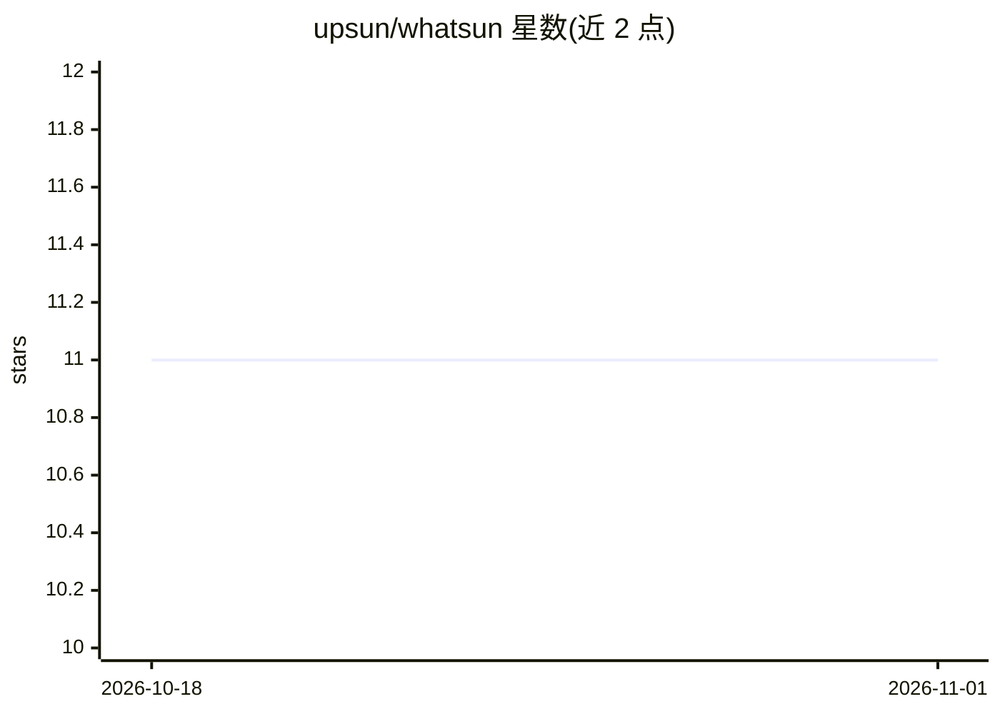

# upsun/whatsun

⭐ 11 · Go · MIT · 推送 2026-10-16 · [GitHub](https://github.com/upsun/whatsun) · 组织维护

**生成仓库摘要供 LLM 上下文使用的代码分析工具**

Whatsun 是一个命令行工具与 Go 库，用于代码分析：主要用途是生成仓库 digest（精简、token 高效的摘要），可放入 LLM prompt 为代码任务提供上下文。提供四个 CLI 命令：digest 生成含技术检测与关键文件内容的摘要、analyze 执行基于规则的分析、deps 列出依赖、tree 展示文件结构。核心能力包括多语言依赖检测、基于 CEL 表达式的可配置规则、Git exclude 处理、缓存与并行处理，以及 .aiignore/.aiexclude 过滤与密钥检测清洗。通过 go install 安装 CLI，或 go get 作为库使用。

## 筛选速览

| 维度 | 判定 | 备注 |
|---|---|---|
| AI 角色 | `ai-ecosystem` | LLM/agent 周边工具 |
| 许可风险 | `permissive` | MIT |
| 部署形态 | `library` | 以包/库形式分发 |
| 模型依赖 | — | README 未给出锁定关系 |
| 硬件要求 | — | 无带数字的原话,不猜 |
| 安装摩擦 | `low` | 无编译、无系统依赖或容器化 |
| 成熟度 | — | 结构信号不足 |

## 能力要点

- 生成 token 高效的仓库 digest 供 LLM prompt 使用
- 多语言依赖检测（Go/JS/Python/Java/PHP/Ruby/Rust 等）
- CEL 表达式定义的可配置分析规则
- 支持 .aiignore/.aiexclude 过滤与密钥检测清洗

## 适用场景

- 为 LLM 代码任务准备仓库上下文
- 检测项目的框架、构建工具与包管理器
- 查看仓库依赖清单与文件结构

## 场景标签

 · 领域:开发工具/代码分析

## 证据(README 行号)

> L5: The primary use case is to generate a repository **digest** (a concise, token-efficient summary), which can be used 
> L6: an LLM prompt to provide context for code-related tasks.
> L12: - **`whatsun digest`** - Generate a repository summary for LLM context, including detected technologies and the con

## 星数曲线

2026-10-18 11 → 2026-11-01 11（+0）

---
*卡片 v1 · prompt 1.4 · 生成 2026-11-01 · 置信度 high · 依据 README sha `066af3f49df7` · [字段定义](../../DATASET.md)*
