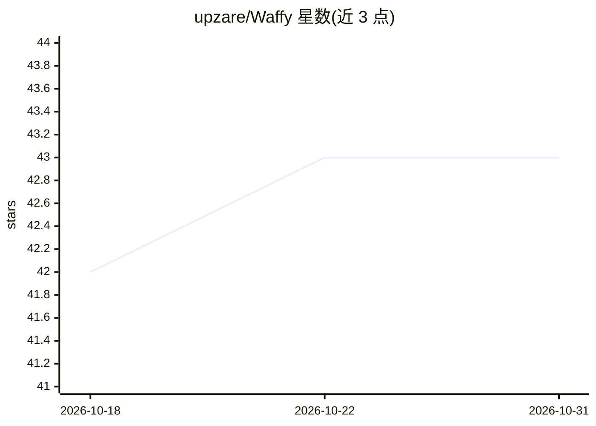

# upzare/Waffy

⭐ 43 · TypeScript · Apache-2.0 · 推送 2026-09-21 · [GitHub](https://github.com/upzare/Waffy) · [官网](https://waffy.io) · 个人维护

**浏览器侧边栏 AI 自动化扩展：自然语言驱动网页操作**

开源 Chromium 浏览器扩展，在侧边栏中提供自然语言驱动的浏览器自动化：可浏览页面、点击元素、填表、提取数据并执行多步工作流。内部为多阶段流水线（规划/执行/验证/输出），各阶段可配置不同模型，执行阶段依赖视觉模型在截图上定位 UI 坐标。支持 OpenAI、Anthropic、Google AI Studio、xAI、Groq、OpenRouter 及浏览器内置端侧模型，API key 本地存储，无自有推理后端。需用 Bun 从源码构建后以开发者模式加载。

## 筛选速览

| 维度 | 判定 | 备注 |
|---|---|---|
| AI 角色 | `ai-native` | 本体是模型或模型工具 |
| 许可风险 | `permissive` | Apache-2.0 |
| 部署形态 | `None` |  |
| 模型依赖 | — | README 未给出锁定关系 |
| 硬件要求 | — | 无带数字的原话,不猜 |
| 安装摩擦 | `low` | 无编译、无系统依赖或容器化 |
| 成熟度 | — | 结构信号不足 |

## 能力要点

- 自然语言规划并执行浏览器操作（点击/填表/提取/多步工作流）
- 规划/执行/验证/输出多阶段流水线，各阶段可独立选模型
- 支持 OpenAI/Anthropic/Google/xAI/Groq/OpenRouter 及浏览器内置端侧模型
- API key 与对话记录本地存储，请求直连用户配置的 AI 提供商

## 适用场景

- 用一句话让 AI 代我完成网页上的表单填写与点击操作
- 让 AI 浏览网页并提取所需数据
- 执行多步骤的网页重复性任务

## 场景标签

`浏览器自动化` · 领域:效率与自动化

## 证据(README 行号)

> L3: Waffy is an open-source browser extension that brings AI-powered browser automation to your side panel. Describe wha
> L9: - **Multi-stage pipeline** — Separate models for planning, execution, validation, and output so each step can use th
> L37: |**Execution**|Drives browser actions from screenshots|Use a **vision model with spatial reasoning and image ground

## 星数曲线

2026-10-18 42 → 2026-10-31 43（+1）

---
*卡片 v1 · prompt 1.4 · 生成 2026-10-25 · 置信度 high · 依据 README sha `91de06458d5a` · [字段定义](../../DATASET.md)*
