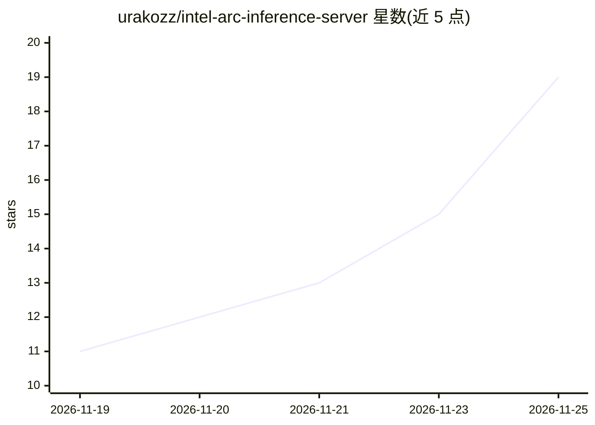

# urakozz/intel-arc-inference-server

⭐ 19 · C++ · AGPL-3.0 · 推送 2026-11-21 · [GitHub](https://github.com/urakozz/intel-arc-inference-server) · 个人维护

**面向 Intel Arc Pro B70 显卡的本地 LLM 推理服务器**

从零编写的针对一至两张 Intel Arc Pro B70 显卡的 LLM 推理服务器，自带手写 GPU 内核，不依赖 PyTorch 或 vLLM 作为底层。提供 OpenAI 兼容 API，面向长编码 agent 会话场景；支持 MTP/DFlash 投机解码、前缀缓存、tp/replica/pp 多卡并行与 int8 KV cache。仅支持 Linux，需 xe 驱动、Level Zero、GCC 16 与 Rust，从源码 CMake 构建。AGPL-3.0 许可，另提供商业许可。

## 筛选速览

| 维度 | 判定 | 备注 |
|---|---|---|
| AI 角色 | `ai-ecosystem` | LLM/agent 周边工具 |
| 许可风险 | `dual` | AGPL-3.0 |
| 部署形态 | `None` |  |
| 模型依赖 | — | README 未给出锁定关系 |
| 硬件要求 | — | 无带数字的原话,不猜 |
| 安装摩擦 | `medium` | 含编译或系统依赖之一 |
| 成熟度 | — | 结构信号不足 |

## 能力要点

- OpenAI 兼容 API 的本地推理服务器，无 PyTorch/vLLM 底层依赖
- 支持 MTP 与 DFlash 投机解码、前缀缓存、int8 KV cache
- 支持 tp/replica/pp 三种多卡并行模式，可按并发数自动分配上下文
- 支持 Qwen3.8-27B、Ornith 1.5、Qwen3.8-Flash-Next 等模型

## 适用场景

- 在 Intel Arc Pro B70 上本地部署大模型服务
- 为 opencode 等编码 agent 提供长上下文推理后端
- 在单卡或双卡间灵活配置并发与并行策略

## 场景标签

`推理引擎` · 领域:训练与推理

## 证据(README 行号)

> L3: **A fast LLM server for one or two Intel Arc Pro B70 cards, written from scratch.** Hand-crafted GPU kernels,
> L4: optimised for each model it runs - no PyTorch, no vLLM underneath - and an OpenAI-compatible API built for long codi
> L86: You need Linux with the `xe` driver, Intel's compute runtime with `ocloc` and the Level Zero loader, GCC 16 (`g++-1

## 星数曲线

2026-11-19 11 → 2026-11-25 19（+8）

---
*卡片 v1 · prompt 1.4 · 生成 2026-11-19 · 置信度 high · 依据 README sha `03e136ac4d98` · [字段定义](../../DATASET.md)*
