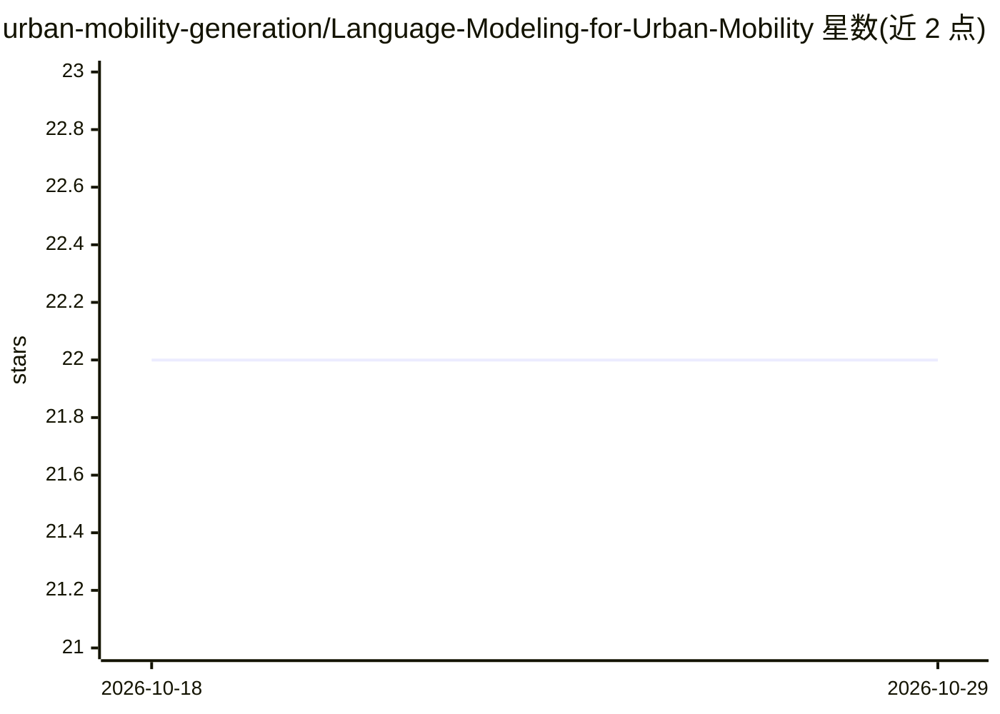

# urban-mobility-generation/Language-Modeling-for-Urban-Mobility

⭐ 22 · MIT · 推送 2026-01-14 · [GitHub](https://github.com/urban-mobility-generation/Language-Modeling-for-Urban-Mobility) · 组织维护

**语言建模用于城市移动性的数据中心综述论文与资源清单**

伴随同名综述论文（Data-Centric Review and Guidelines）维护的 Awesome 类论文清单：系统收集语言建模范式（预训练语言模型、LLM、MLLM、扩散模型）应用于城市移动性研究的论文与代码，沿三个维度组织——移动性数据的 tokenization/encoding/prompting 转换、语言模型类别选择、下游城市任务应用。另收录 Nature/Science/PNAS 系列移动性研究、相关综述与论文列表。面向城市计算与时空数据挖掘方向的研究者，条目多附论文与代码链接。

## 筛选速览

| 维度 | 判定 | 备注 |
|---|---|---|
| AI 角色 | `ai-knowledge` | 知识聚合/清单类 |
| 许可风险 | `permissive` | MIT |
| 部署形态 | `None` |  |
| 模型依赖 | — | README 未给出锁定关系 |
| 硬件要求 | — | 无带数字的原话,不猜 |
| 安装摩擦 | `low` | 无编译、无系统依赖或容器化 |
| 成熟度 | — | 结构信号不足 |

## 能力要点

- 按 tokenization/encoding 等维度组织语言建模×城市移动性论文
- 覆盖预训练 LM、LLM、MLLM、扩散模型四类模型综述
- 收录 Nature/Science/PNAS 移动性研究与相关 survey
- 大量条目附论文与代码仓库链接

## 适用场景

- 查找轨迹预测、移动性生成等方向的 LLM 相关论文与代码
- 调研语言建模在城市移动性领域的研究进展
- 为综述写作收集跨学科移动性研究文献

## 场景标签

`精选清单` · 领域:学习与行业

## 证据(README 行号)

> L6: > This repository contains a collection of resources and papers on applying language modeling paradigms to urban mob
> L10: We propose a comprehensive and data-centric survey of language modeling for urban mobility, structured along three 

## 星数曲线

2026-10-18 22 → 2026-10-29 22（+0）

---
*卡片 v1 · prompt 1.4 · 生成 2026-10-27 · 置信度 high · 依据 README sha `517c5ee78b7e` · [字段定义](../../DATASET.md)*
