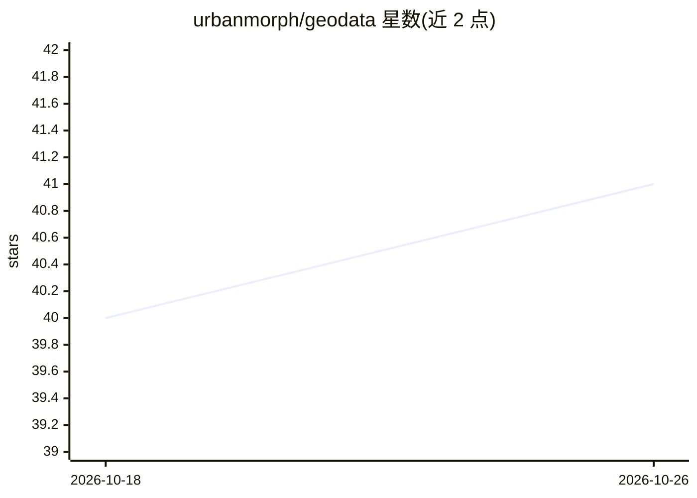

# urbanmorph/geodata

⭐ 41 · TypeScript · MIT · 推送 2026-10-24 · [GitHub](https://github.com/urbanmorph/geodata) · 组织维护

**印度行政边界开放地理数据目录，含 REST API 与 MCP 服务器**

bharatlas 是面向印度地理数据的可视化目录与平台：收录国家、邦、县、区、村（LGD）等行政边界及选区、生态区、6.3 万邮编多边形等图层，支持按图层筛选并以 Parquet/PMTiles/GeoJSON/KML/Shapefile 五种格式下载。提供无密钥的 REST API（list/query/locate/nearby）、移动端众包采集工具 collect、匿名提交流程，以及供 LLM 使用的 MCP 服务器（17 个工具，npm 分发，兼作 Claude Code 插件）。数据存于 Cloudflare R2，提交需策展人审核，各图层携带各自开放许可，法律用途建议回溯上游源。

## 筛选速览

| 维度 | 判定 | 备注 |
|---|---|---|
| AI 角色 | `ai-enhanced` | 去掉 AI 部分产品仍成立 |
| 许可风险 | `permissive` | MIT |
| 部署形态 | `library` | 以包/库形式分发 |
| 模型依赖 | — | README 未给出锁定关系 |
| 硬件要求 | — | 无带数字的原话,不猜 |
| 安装摩擦 | `low` | 无编译、无系统依赖或容器化 |
| 成熟度 | — | 结构信号不足 |

## 能力要点

- 邦到村五级 LGD 行政边界，跨源备选（SOI/Bhuvan/geoBoundaries/PMGSY）
- REST API：list/query/filter/group_by/point-in-polygon locate/nearby
- MCP 服务器 17 个工具（读取 + collect 创作），npm 与 Claude Code 插件分发
- collect 移动众包采集：表单链接、无账号打点、token 权限分级

## 适用场景

- 查找并下载印度各级行政边界的开放地理数据
- 让 Claude/GPT/Cursor 等 LLM 通过 MCP 查询印度地理图层
- 用手机链接发起众包地图采集并审核发布到目录

## 场景标签

 · 领域:地理空间/开放数据

## 证据(README 行号)

> L9: A visual catalog, REST API, MCP server, drag-drop verifier, anonymous contribution flow, and a mobile crowd map-capt
> L24: - **MCP** (`npx bharatlas-mcp@latest`) – 17 tools for LLMs. Read (list, schema, query, locate, nearby, categories, 
> L52: - **MCP server** – `bharatlas-mcp`, 17 tools (read + collect authoring) for Claude, GPT, Gemini, Cursor, etc.; also

## 星数曲线

2026-10-18 40 → 2026-10-26 41（+1）

---
*卡片 v1 · prompt 1.4 · 生成 2026-10-25 · 置信度 high · 依据 README sha `304c12700580` · [字段定义](../../DATASET.md)*
