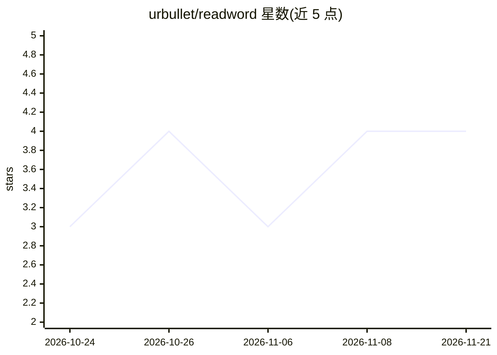

# urbullet/readword

⭐ 4 · Ruby · MIT · 推送 2026-10-22 · [GitHub](https://github.com/urbullet/readword) · 个人维护

**纯 Ruby 的 Word 转 Markdown 工具，供 LLM 与编码 agent 读取**

将 .doc（Word 97-2003）与 .docx（Word 2007+）文件转为 Markdown，不依赖 LibreOffice、Java 或 antiword。保留标题、列表嵌套与编号、表格、页眉页脚、脚注、修订（按已接受处理）等，丢弃下划线、颜色、图片与嵌入对象。面向 LLM 与编码 agent 场景设计：提供 --max-characters 限制以适配上下文窗口，内置解压大小上限、实体拒绝与链接白名单等对不可信文件的防护，并给出与 Tika/LibreOffice/textutil/anydoc/antiword 的对比测试数据。CLI 与 Ruby API 两种用法，MIT 许可。

## 筛选速览

| 维度 | 判定 | 备注 |
|---|---|---|
| AI 角色 | `ai-enhanced` | 去掉 AI 部分产品仍成立 |
| 许可风险 | `permissive` | MIT |
| 部署形态 | `None` |  |
| 模型依赖 | — | README 未给出锁定关系 |
| 硬件要求 | — | 无带数字的原话,不猜 |
| 安装摩擦 | `low` | 无编译、无系统依赖或容器化 |
| 成熟度 | — | 结构信号不足 |

## 能力要点

- 同时读取 .doc 与 .docx，纯 Ruby 实现 .doc 解析
- 针对不可信文件的防护：大小限制、实体拒绝、链接白名单、300 万次 fuzz 测试
- --max-characters 参数用于适配模型上下文窗口
- 提供 Ruby API（Readword.convert/convert_file）与命令行两种用法

## 适用场景

- 让编码 agent（通过 CLAUDE.md/AGENTS.md 配置）读取 Word 文档
- 批量把 Word 技术文档转成 Markdown 供模型处理
- 处理来源不可信的 Word 文件时限制内存消耗

## 场景标签

`文档解析` · 领域:知识与检索

## 证据(README 行号)

> L3: Turn Word documents into Markdown, in plain Ruby. It reads both formats, Word 97-2003 `.doc` and Word 2007+ `.docx`,
> L25: ## Use it with a coding agent

## 星数曲线

2026-10-24 3 → 2026-11-21 4（+1）

---
*卡片 v1 · prompt 1.4 · 生成 2026-11-21 · 置信度 mid · 依据 README sha `05c7f287d6eb` · [字段定义](../../DATASET.md)*
