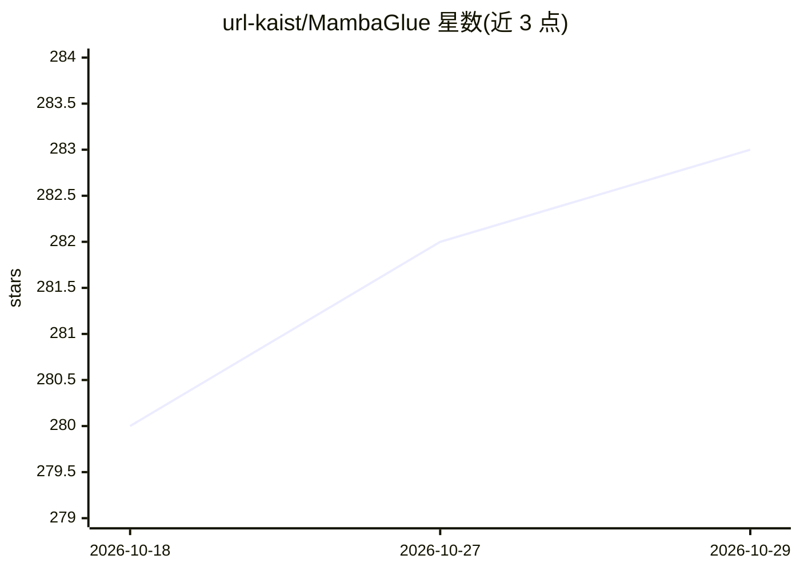

# url-kaist/MambaGlue

⭐ 283 · Python · Apache-2.0 · 推送 2026-05-21 · [GitHub](https://github.com/url-kaist/MambaGlue) · 组织维护

**Mamba+Transformer 混合架构的图像局部特征匹配网络（ICRA'25）**

KAIST 团队发表的 MambaGlue：将 Mamba 与 Transformer 混合用于两张图像间局部特征匹配，推理 API 与 LightGlue 对齐，可一行替换 LightGlue 匹配器接入现有管线；支持 SuperPoint/DISK/ALIKED/SIFT 四种前端提取器，并支持与 LightGlue 同约定的点剪枝。提供实验性 Glue Factory 训练适配器，但论文未披露训练超参，默认沿用 LightGlue；已发布权重为预出版版本，在 MegaDepth1500 上低于论文数值，复现需从头训练。需先编译 Mamba 的 CUDA 选择性扫描核，Linux+NVIDIA GPU 环境测试；提供 Docker 镜像绕开 CUDA 编译问题；hloc 分支（SfM/视觉定位集成）尚未推送。Apache-2.0 许可。

## 筛选速览

| 维度 | 判定 | 备注 |
|---|---|---|
| AI 角色 | `ai-native` | 本体是模型或模型工具 |
| 许可风险 | `permissive` | Apache-2.0 |
| 部署形态 | `library` | 以包/库形式分发 |
| 模型依赖 | — | README 未给出锁定关系 |
| 硬件要求 | — | 无带数字的原话,不猜 |
| 安装摩擦 | `medium` | 含编译或系统依赖之一 |
| 成熟度 | `idea` | |

## 能力要点

- Mamba 与 Transformer 混合架构的局部特征匹配网络（ICRA 2025 论文）
- 推理 API 与 LightGlue 对齐，可一行替换接入现有管线
- 支持 superpoint/disk/aliked/sift 前端与点剪枝（width/depth_confidence）
- 提供 Glue Factory 训练适配器与 Docker 镜像（rkh137/glue）

## 适用场景

- 在已有 LightGlue 特征匹配管线中替换匹配器进行图像匹配
- 复现论文的两阶段训练（合成单应→MegaDepth）
- 相对位姿估计相关研究中的特征匹配实验

## 场景标签

`图像视频处理` · 领域:感知与多模态

## 证据(README 行号)

> L17:  MambaGlue is a hybrid neural network combining the Mamba and the Transformer architectures to match local features
> L58: from mambaglue import MambaGlue, SuperPoint, match_pair

## 星数曲线

2026-10-18 280 → 2026-10-29 283（+3）

---
*卡片 v1 · prompt 1.4 · 生成 2026-10-22 · 置信度 mid · 依据 README sha `1d3a83f5c2ed` · [字段定义](../../DATASET.md)*
