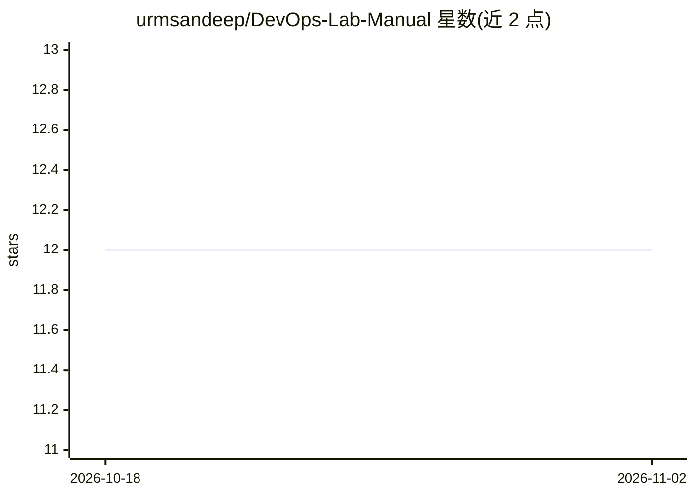

# urmsandeep/DevOps-Lab-Manual

⭐ 12 · 推送 2025-11-22 · [GitHub](https://github.com/urmsandeep/DevOps-Lab-Manual) · 个人维护

**面向本科生的 DevOps 课程实验手册与练习集**

教学用 DevOps 学习资源仓库：包含课程笔记（进行中）、动手练习、模拟行业场景的作业与精选参考资料；内容覆盖 Docker、Kubernetes、Jenkins、CI/CD、基础设施即代码与 DevSecOps，按本科课程结构组织。由讲授 DevOps 课程的教师整理，面向希望获得 DevOps 工具与工作流实践经验、准备行业挑战的本科生。仓库本身为文档与练习集合，不提供可安装运行的软件；部分板块（工具技巧、最佳实践、DevSecOps）标注为待添加。

## 筛选速览

| 维度 | 判定 | 备注 |
|---|---|---|
| AI 角色 | `ai-knowledge` | 知识聚合/清单类 |
| 许可风险 | `none` | — |
| 部署形态 | `None` |  |
| 模型依赖 | — | README 未给出锁定关系 |
| 硬件要求 | — | 无带数字的原话,不猜 |
| 安装摩擦 | `low` | 无编译、无系统依赖或容器化 |
| 成熟度 | `idea` | |

## 能力要点

- 覆盖容器化、Kubernetes 编排、CI/CD 流水线、基础设施即代码的动手练习
- 模拟行业场景的作业与精选参考文章/视频
- 内容结构对齐本科课程大纲

## 适用场景

- 按课程结构系统学习 DevOps 概念与工具
- 通过动手练习掌握 Docker、Kubernetes、Jenkins
- 准备贴近行业实践的 DevOps 作业与项目

## 场景标签

`教程课程` · 领域:学习与行业

## 证据(README 行号)

> L3: Welcome to the **DevOps Lab Manual**, your starter guide to mastering DevOps concepts! This repository is curated to
> L24: This repository is designed for **undergraduate students** who are:

## 星数曲线

2026-10-18 12 → 2026-11-02 12（+0）

---
*卡片 v1 · prompt 1.4 · 生成 2026-10-31 · 置信度 high · 依据 README sha `b151fb4dd186` · [字段定义](../../DATASET.md)*
