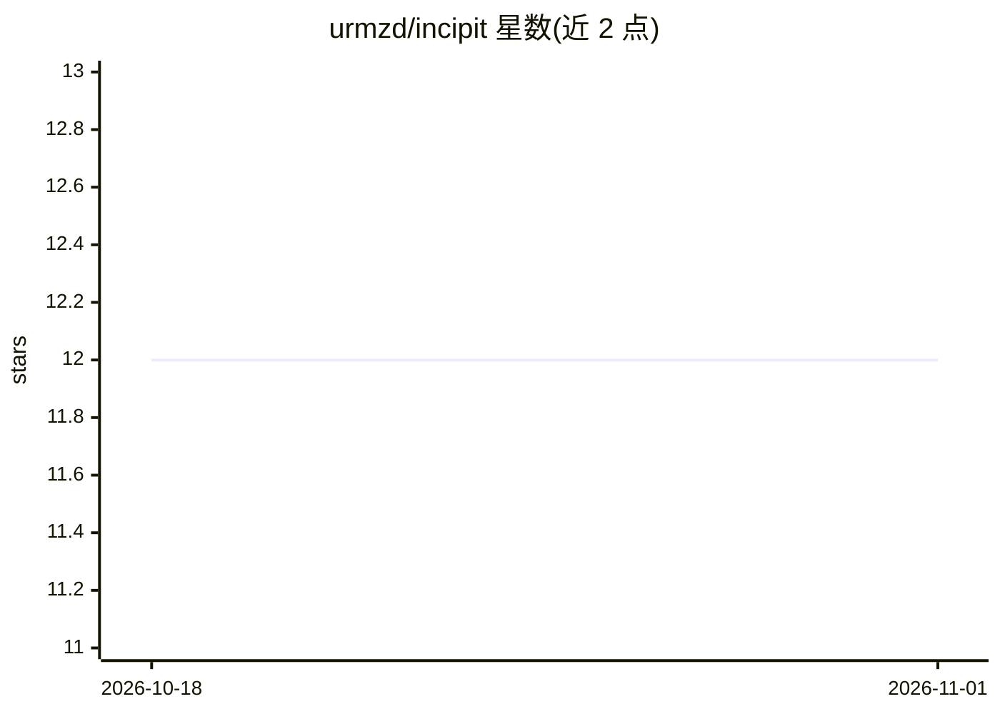

# urmzd/incipit

⭐ 12 · Go · Apache-2.0 · 推送 2026-10-29 · [GitHub](https://github.com/urmzd/incipit) · 个人维护

**结构化简历数据转多格式文档的 CLI，附可管道化的 AI 提示词**

Go 编写的命令行工具：读取 JSON/Markdown 格式的简历数据，通过模块化模板系统渲染为 PDF（经 HTML+Chromium 或 LaTeX）、DOCX、HTML、Markdown 输出；可导出 JSON Schema 用于 IDE 校验，每次运行生成带时间戳的输出目录并以 latest/ 索引指向最新结果。AI 部分为 ai 子命令，向 stdout 打印自包含的 LLM 提示词用于简历审阅、优化与创建，无需 API key 或网络，可管道给 claude -p 等 agent；另提供遵循 Agent Skills 规范的技能。macOS/Linux 提供安装脚本与源码构建两种方式。

## 筛选速览

| 维度 | 判定 | 备注 |
|---|---|---|
| AI 角色 | `ai-enhanced` | 去掉 AI 部分产品仍成立 |
| 许可风险 | `permissive` | Apache-2.0 |
| 部署形态 | `library` | 以包/库形式分发 |
| 模型依赖 | — | README 未给出锁定关系 |
| 硬件要求 | — | 无带数字的原话,不猜 |
| 安装摩擦 | `low` | 无编译、无系统依赖或容器化 |
| 成熟度 | — | 结构信号不足 |

## 能力要点

- JSON/Markdown 数据驱动渲染为 PDF/DOCX/HTML/Markdown 多种格式
- ai 子命令生成自包含 LLM 提示词，无需 API key，可管道给任意 agent
- JSON Schema 导出与 latest/ 索引式时间戳输出目录
- 模板系统支持自建（templates/<name>/ + metadata.yml）

## 适用场景

- 用 JSON 单一数据源生成多种格式的简历文档
- 把简历转换提示词管道给 LLM 完成文本到结构化 JSON 的转换
- 在 agent 中通过 /resume 技能创建、审阅并生成简历

## 场景标签

 · 领域:文档生成/求职工具

## 证据(README 行号)

> L5:  A CLI tool that converts structured resume data (JSON/Markdown) into polished PDFs, HTML, LaTeX, DOCX, and Markdown
> L34: - **AI Prompts**: generate ready-to-use LLM prompts to review, optimize, and create resumes; pipe them to any LLM o
> L86: The `ai` subcommands print self-contained LLM prompts to stdout. No API keys or network access required. Paste a pr

## 星数曲线

2026-10-18 12 → 2026-11-01 12（+0）

---
*卡片 v1 · prompt 1.4 · 生成 2026-10-31 · 置信度 high · 依据 README sha `6659359f0c7e` · [字段定义](../../DATASET.md)*
