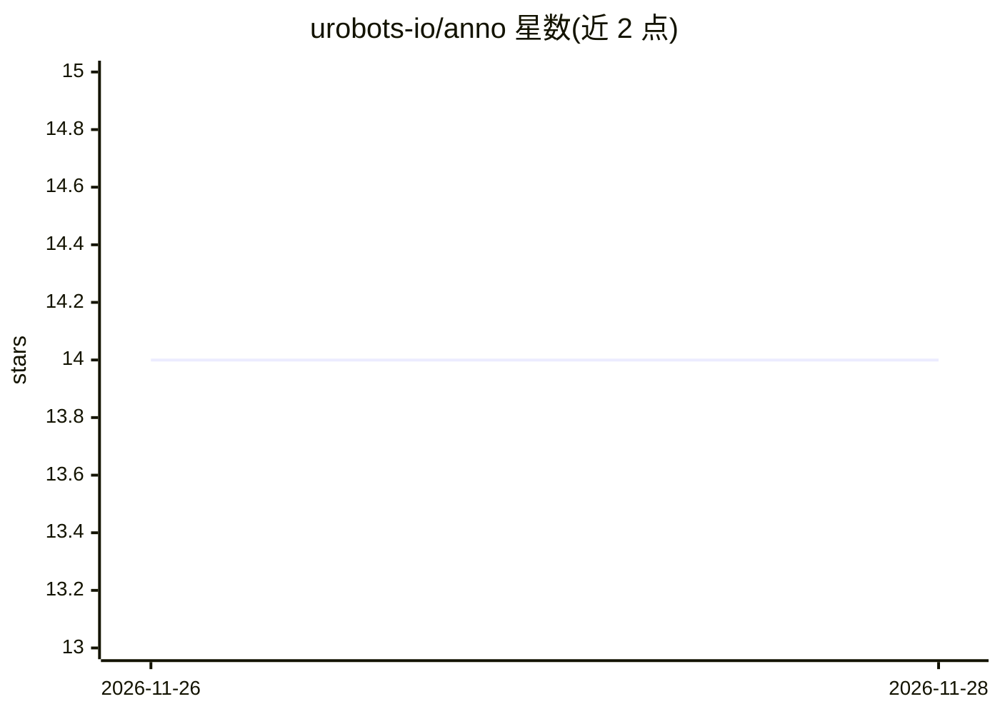

# urobots-io/anno

⭐ 14 · C++ · MIT · 推送 2026-11-25 · [GitHub](https://github.com/urobots-io/anno) · 个人维护

**面向 AI 数据准备的跨平台图像标注工具**

基于 Qt 的桌面图像标注工具，支持 Windows/macOS/Ubuntu 三平台。提供点、带方向点、轴对齐矩形、旋转矩形、多边形、折线等多种标注类型，标注属性间可配置依赖（如共享宽高或位置）。项目文件为 JSON 格式，包含标记定义与标注信息，坐标以像素为单位、角度以弧度表示，界面面向快速亚像素级标注。获取方式为下载 release 预编译二进制，或用 Qt Creator 从源码构建。

## 筛选速览

| 维度 | 判定 | 备注 |
|---|---|---|
| AI 角色 | `ai-enhanced` | 去掉 AI 部分产品仍成立 |
| 许可风险 | `permissive` | MIT |
| 部署形态 | `None` |  |
| 模型依赖 | — | README 未给出锁定关系 |
| 硬件要求 | — | 无带数字的原话,不猜 |
| 安装摩擦 | `low` | 无编译、无系统依赖或容器化 |
| 成熟度 | — | 结构信号不足 |

## 能力要点

- 支持 6 种以上标记类型（点/带方向点/矩形/旋转矩形/多边形/折线）
- 标记属性间可配置依赖（共享宽高或图像位置）
- 项目文件为 JSON 格式，含标记定义与标注数据
- Windows 预编译版支持 EXR 图像格式

## 适用场景

- 为深度学习模型制作图像数据集标注
- 给图像中的目标标注多边形或旋转框
- 团队按统一 JSON 项目格式整理标注数据

## 场景标签

 · 领域:数据标注/计算机视觉工具

## 证据(README 行号)

> L2: Cross-platform tool for labeling image data.
> L6: - Supports a wide range of marker types:

## 星数曲线

2026-11-26 14 → 2026-11-28 14（+0）

---
*卡片 v1 · prompt 1.4 · 生成 2026-11-26 · 置信度 mid · 依据 README sha `2b6fd0cad4b1` · [字段定义](../../DATASET.md)*
