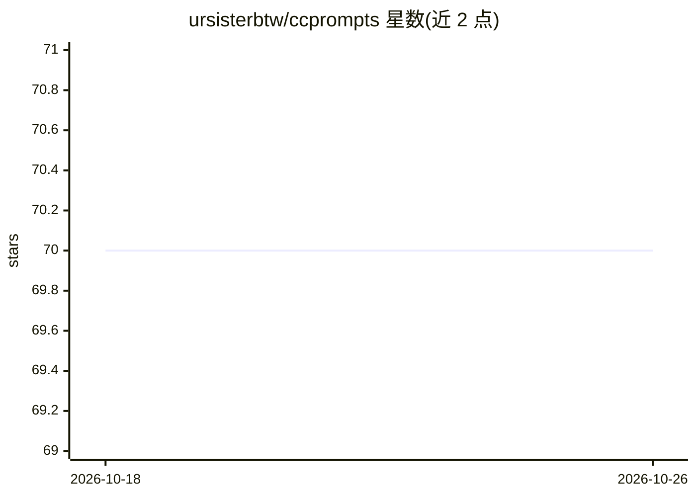

# ursisterbtw/ccprompts

⭐ 70 · JavaScript · MIT · 推送 2026-10-05 · [GitHub](https://github.com/ursisterbtw/ccprompts) · 个人维护

**面向 Claude Code 的插件：70+ 命令与 10 个专用 agent**

Claude Code 插件形式的命令与子代理集合：提供按 12 个开发阶段组织的 70+ 斜杠命令（安全验证、MCP 集成、企业治理、多仓库管理等）、10 个领域专用 AI agent，以及基于 Dagger 容器隔离的命令执行安全系统和多维校验引擎（结构/安全/质量/性能）。支持插件市场安装或 git clone 源码方式使用并自定义；含 agent 模板向导生成新的子代理。README 声明仓库处于活跃开发中，可能存在 bug 与破坏性变更。

## 筛选速览

| 维度 | 判定 | 备注 |
|---|---|---|
| AI 角色 | `ai-ecosystem` | LLM/agent 周边工具 |
| 许可风险 | `permissive` | MIT |
| 部署形态 | `None` |  |
| 模型依赖 | locked-api |  |
| 硬件要求 | — | 无带数字的原话,不猜 |
| 安装摩擦 | `low` | 无编译、无系统依赖或容器化 |
| 成熟度 | `idea` | |

## 能力要点

- 70+ 按开发阶段组织的斜杠命令
- 10 个领域专用 AI agent 与模板向导生成系统
- Dagger 容器隔离的命令执行与 safe-run.sh 脚本
- 可通过 Claude Code 插件市场一键安装并自动更新

## 适用场景

- 为 Claude Code 补充覆盖完整开发流程的命令集
- 团队通过共享插件配置统一工作流
- 基于模板向导创建自己领域的专用子代理

## 场景标签

`提示工程` `编码 Agent` · 领域:Agent 开发

## 证据(README 行号)

> L7: **ccprompts** is a comprehensive Claude Code plugin featuring 70+ commands across 12 development phases,
> L8: 10 specialized AI agents, and a Dagger-based safety system. Install as a plugin for instant access
> L81: ccprompts can be installed as a Claude Code plugin, giving you instant access to all 70+ commands

## 星数曲线

2026-10-18 70 → 2026-10-26 70（+0）

---
*卡片 v1 · prompt 1.4 · 生成 2026-10-24 · 置信度 high · 依据 README sha `e9103f667bbd` · [字段定义](../../DATASET.md)*
