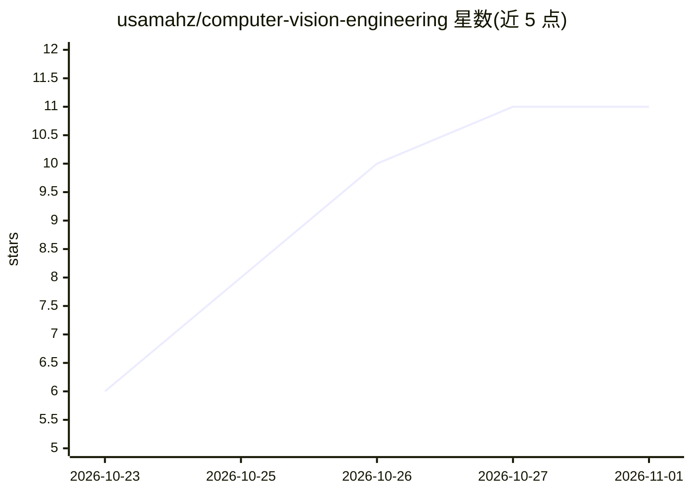

# usamahz/computer-vision-engineering

⭐ 11 · Python · MIT · 推送 2026-10-21 · [GitHub](https://github.com/usamahz/computer-vision-engineering) · [官网](ai.usamah.me) · 个人维护

**计算机视觉工程化学习路径清单：从光学传感器到生产部署**

按依赖顺序组织的计算机视觉工程阅读路径：从成像（光学、传感器、ISP、色彩、噪声）到经典几何基础、数据集与标注、评测指标，再到生产环境问题。只收录一手来源（论文、规范、官方模型卡、仓库、文档），每个条目的数字需带完整字段；每节附带 misc/benchmarks/ 下可运行的基准（含源、锁定的环境、机器、原始数据与分析）。范围排除机器人控制、纯图形学与无视觉后果的通用机器学习。面向希望系统掌握视觉系统全链条的工程师与研究者。

## 筛选速览

| 维度 | 判定 | 备注 |
|---|---|---|
| AI 角色 | `ai-knowledge` | 知识聚合/清单类 |
| 许可风险 | `permissive` | MIT |
| 部署形态 | `None` |  |
| 模型依赖 | — | README 未给出锁定关系 |
| 硬件要求 | — | 无带数字的原话,不猜 |
| 安装摩擦 | `low` | 无编译、无系统依赖或容器化 |
| 成熟度 | — | 结构信号不足 |

## 能力要点

- 按依赖顺序组织的一手来源阅读路径，覆盖成像到部署全链条
- 证据分级：每个条目数字须携带规定字段，被拒条目记录于 changelog
- 每节附可运行基准，源、环境、机器与原始数据全部提交
- 覆盖数据集标注误差、评测协议差异等工程化议题

## 适用场景

- 系统学习计算机视觉工程化知识，从传感器原理到生产部署
- 查证某指标或数据集的定义出处与协议差异
- 运行各节基准复现论文中的关键论断

## 场景标签

`精选清单` `模型评测` · 领域:评测与运维

## 证据(README 行号)

> L5: Shipping a vision system means knowing what a pixel measured, what a metric counted, and which number in a paper wil
> L9: **Evidence.** Primary sources only: the paper, the specification, the official model card, the repository, or the do
> L11: **Proof.** Every section ends in a benchmark under misc/benchmarks/: the source, the pinned environment, the machin

## 星数曲线

2026-10-23 6 → 2026-11-01 11（+5）

---
*卡片 v1 · prompt 1.4 · 生成 2026-11-01 · 置信度 high · 依据 README sha `fe5e7c23df34` · [字段定义](../../DATASET.md)*
