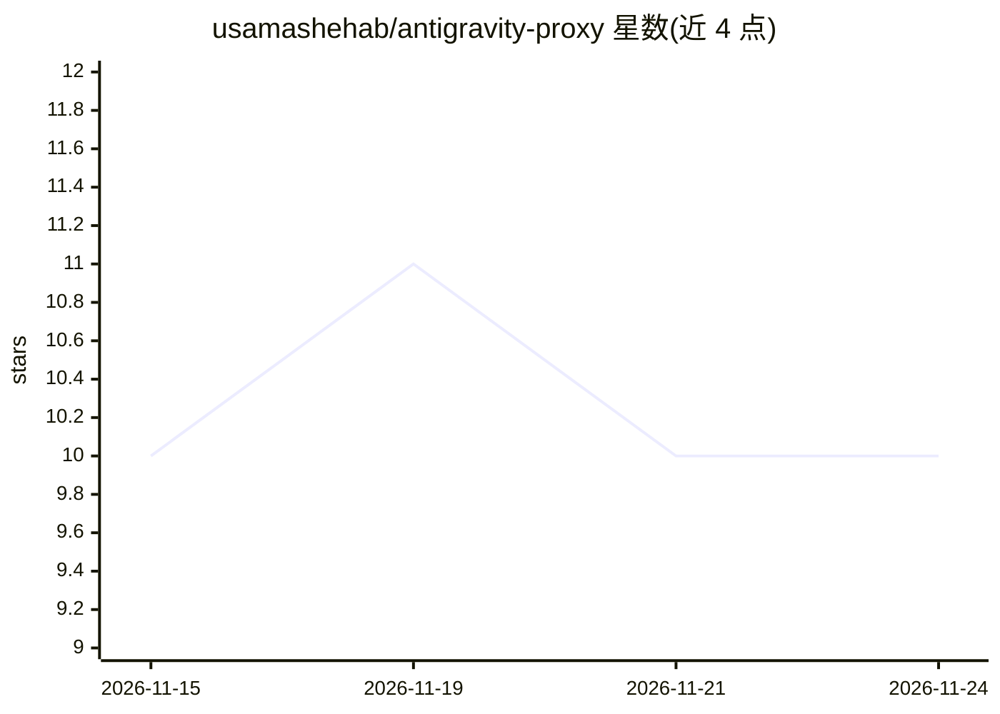

# usamashehab/antigravity-proxy

⭐ 10 · Python · MIT · 推送 2026-07-10 · [GitHub](https://github.com/usamashehab/antigravity-proxy) · 个人维护

**把 Antigravity 的 Gemini/Claude 模型转成 OpenAI 兼容接口的本地代理**

纯 Python 标准库实现的本地代理（默认 127.0.0.1:8877），读取 Antigravity CLI 的 OAuth 令牌，将其内部 Cloud Code Assist API 转为 OpenAI chat completions 与原生 Gemini passthrough 两个端点，供任意 OpenAI 兼容客户端调用 Gemini 与 Claude 模型，无需 API key。支持工具/函数调用、SSE 流式、图片输入、JSON schema 结构化输出、模型名自动映射与令牌自动刷新。需 Python 3.10+ 与已认证的 Antigravity CLI；代理本身无鉴权层，配额受 Google Antigravity 限制。

## 筛选速览

| 维度 | 判定 | 备注 |
|---|---|---|
| AI 角色 | `ai-ecosystem` | LLM/agent 周边工具 |
| 许可风险 | `permissive` | MIT |
| 部署形态 | `library` | 以包/库形式分发 |
| 模型依赖 | — | README 未给出锁定关系 |
| 硬件要求 | — | 无带数字的原话,不猜 |
| 安装摩擦 | `low` | 无编译、无系统依赖或容器化 |
| 成熟度 | — | 结构信号不足 |

## 能力要点

- OpenAI 兼容 /v1/chat/completions + 原生 Gemini passthrough 双端点
- 工具/函数调用（含 conversation round-trip）与 SSE 流式
- OAuth 令牌自动刷新，模型友好名自动映射
- 零 pip 依赖，附 systemd service 配置

## 适用场景

- 让 Aider/Continue/Claude Code 等工具走本地代理调用 Gemini/Claude 模型
- 本地开发环境免 API key 调用模型进行实验
- 需要图片输入或 JSON schema 结构化输出的客户端走 Gemini 原生端点

## 场景标签

`模型网关` · 领域:Agent 开发

## 证据(README 行号)

> L14: A lightweight **OpenAI-compatible proxy** that bridges any AI tool to **Google Antigravity's** internal Cloud Code 
> L23: - **Universal** — works with any OpenAI-compatible tool (Aider, Continue, Hermes, Claude Code, OpenAI SDK, LangChai
> L36: - **Zero pip dependencies** — Python 3.10+ standard library only

## 星数曲线

2026-11-15 10 → 2026-11-24 10（+0）

---
*卡片 v1 · prompt 1.4 · 生成 2026-11-19 · 置信度 mid · 依据 README sha `14012cea75e6` · [字段定义](../../DATASET.md)*
