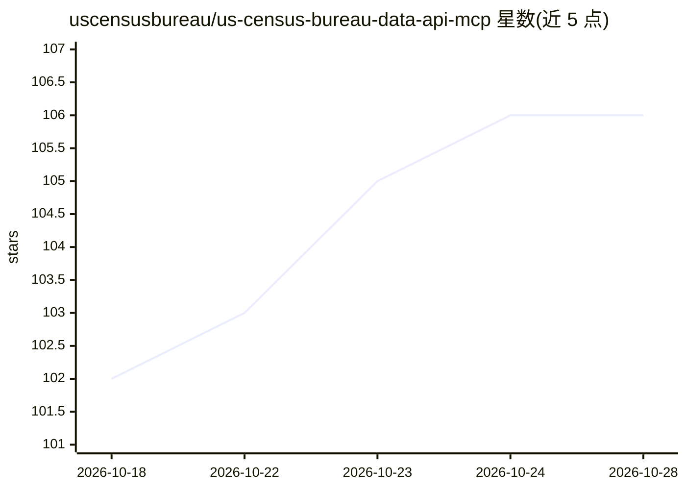

# uscensusbureau/us-census-bureau-data-api-mcp

⭐ 106 · TypeScript · CC0-1.0 · 推送 2026-03-13 · [GitHub](https://github.com/uscensusbureau/us-census-bureau-data-api-mcp) · [官网](https://www.census.gov) · 组织维护

**连接 AI 助手与美国人口普查局官方统计数据的 MCP 服务器**

美国人口普查局官方维护的 Model Context Protocol (MCP) 服务器，基于 MCP TypeScript SDK 构建，向 AI 助手提供 Census Data API 及其他官方数据源。部分 API 数据拉取到本地 Postgres 容器以增强搜索性能。暴露 tools/list、tools/call、prompts/list、prompts/get 方法，含数据集列表、地理层级获取、聚合数据获取、FIPS 地理编码解析等工具，以及人口统计预置 prompt。运行需 Census API key、Docker 与 Node 18+。

## 筛选速览

| 维度 | 判定 | 备注 |
|---|---|---|
| AI 角色 | `ai-ecosystem` | LLM/agent 周边工具 |
| 许可风险 | `viral` | CC0-1.0 |
| 部署形态 | `self-host` | docker 或自建部署 |
| 模型依赖 | — | README 未给出锁定关系 |
| 硬件要求 | — | 无带数字的原话,不猜 |
| 安装摩擦 | `low` | 无编译、无系统依赖或容器化 |
| 成熟度 | — | 结构信号不足 |

## 能力要点

- 提供 4 个数据获取工具（数据集/地理层级/聚合数据/FIPS 解析）
- 本地 Postgres 容器缓存部分数据以提升搜索性能
- 包含 get_population_data 预置 prompt，自动将地名解析为 FIPS 码

## 适用场景

- 让 AI 助手查询美国官方人口与统计数据
- 通过自然语言地名获取对应地理区域的普查数据

## 场景标签

`数据分析` · 领域:效率与自动化

## 证据(README 行号)

> L12: The *U.S. Census Bureau Data API MCP* is a Model Context Protocol (MCP) server that connects AI assistants with dat
> L55: The U.S. Census Bureau Data API MCP server uses data from the Census Data API and other official sources to constru

## 星数曲线

2026-10-18 102 → 2026-10-28 106（+4）

---
*卡片 v1 · prompt 1.4 · 生成 2026-10-23 · 置信度 high · 依据 README sha `ce80ddde390b` · [字段定义](../../DATASET.md)*
