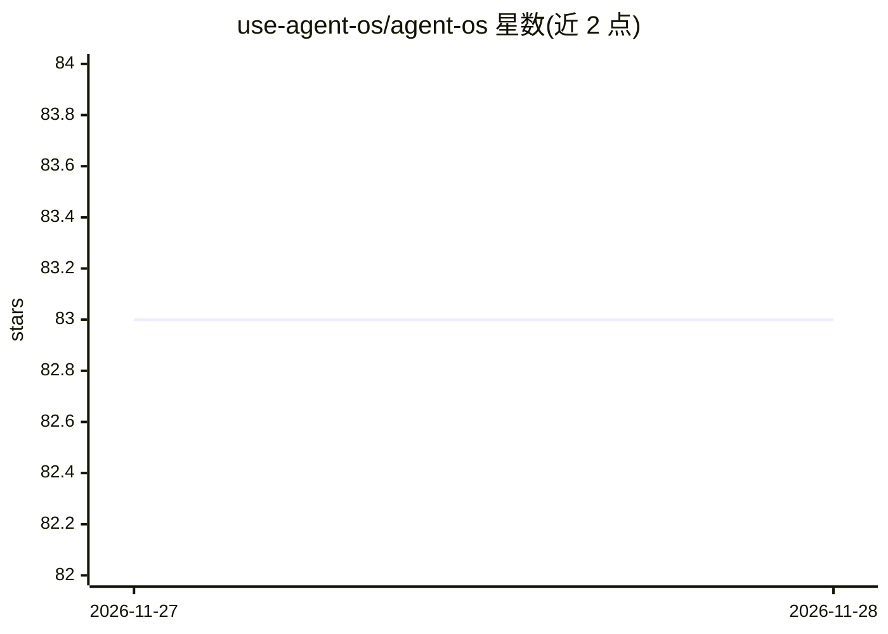

# use-agent-os/agent-os

⭐ 83 · Python · Apache-2.0 · 推送 2026-11-27 · [GitHub](https://github.com/use-agent-os/agent-os) · [官网](https://useagentos.dev) · 组织维护

**本地优先的开源 AI 交易代理：链上兑换、跨链、定投与止损**

一个开源、本地优先的 AI 代理，持有自身的 EVM 钱包，通过 AgentOS DEX 在 Base 与 Robinhood Chain 上执行兑换、跨链、定投和止盈/止损挂单；私钥存于本机加密保险库，签名在本地完成，网关按每单/每日上限与价格冲击等护栏拦截订单。除交易外它也是通用代理：20+ 模型提供方、50+ 技能与 MCP、本地记忆、沙箱隔离工具运行，桌面应用、Web UI、CLI、Telegram 等多入口共享同一网关。需自备模型 API key；交易涉及真实资金且不可撤销。

## 筛选速览

| 维度 | 判定 | 备注 |
|---|---|---|
| AI 角色 | `ai-native` | 本体是模型或模型工具 |
| 许可风险 | `permissive` | Apache-2.0 |
| 部署形态 | `desktop` | 安装包/桌面程序 |
| 模型依赖 | local-ok | 支持本地模型 |
| 硬件要求 | — | 无带数字的原话,不猜 |
| 安装摩擦 | `low` | 无编译、无系统依赖或容器化 |
| 成熟度 | — | 结构信号不足 |

## 能力要点

- 本机加密保险库保管私钥，签名在本地完成，服务端不持有密钥
- 网关强制执行护栏：100 美元单笔阈值、每日 1,000 美元上限、5% 价格冲击审批
- Pilot Router 本地分类消息并按成本选择四个层级的模型
- 支持 20+ 模型提供方与 50+ 技能，可加载 MCP 工具也可作为 MCP 服务

## 适用场景

- 在 Base 与 Robinhood Chain 上通过对话执行代币兑换与跨链
- 设置按周定投与止盈/止损条件单，无人值守按计划执行
- 让代理研究代币并定时把报告发送到 Telegram/Slack/邮件

## 场景标签

`金融量化` · 领域:学习与行业

## 证据(README 行号)

> L3:  AgentOS — The AI agent that trades for you. Your machine, your keys.
> L24: AgentOS is an open-source AI agent that holds its own EVM wallets and
> L50: - **The gateway enforces the limits, not the model.** A prompt cannot talk

## 星数曲线

2026-11-27 83 → 2026-11-28 83（+0）

---
*卡片 v1 · prompt 1.4 · 生成 2026-11-27 · 置信度 high · 依据 README sha `eb6e02b432e1` · [字段定义](../../DATASET.md)*
