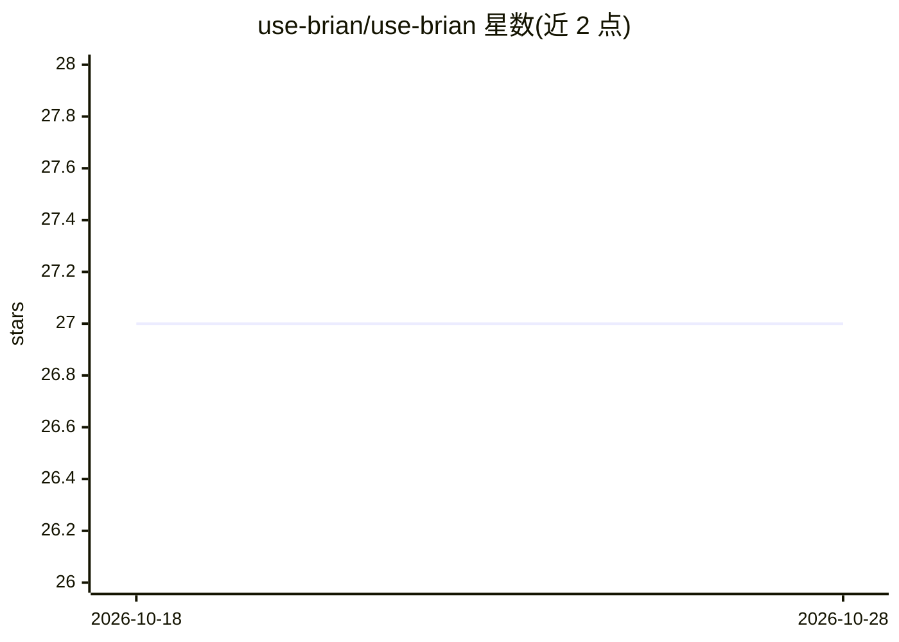

# use-brian/use-brian

⭐ 27 · TypeScript · AGPL-3.0 · 推送 2026-10-27 · [GitHub](https://github.com/use-brian/use-brian) · [官网](https://usebrian.ai) · 组织维护

**自托管的公司大脑：为独立创始人与小团队记录与执行工作**

面向独立创始人与小团队的开源自托管工作助手：把人、交易、决策沉淀为知识图谱（Brain），通过聊天 Agent 驱动连接器执行研究、起草、发送、归档等动作，支持定时条件工作流，并内置文档/演示/表格、CRM、公开 API 与 MCP server。写操作默认先询问，破坏性操作默认关闭。模型后端支持 Gemini、Qwen/DeepSeek（DashScope）、OpenAI 兼容端点及 ChatGPT 订阅。数据存于本地内嵌数据库，源码安装需 Node 22+ 与 pnpm 10+。

## 筛选速览

| 维度 | 判定 | 备注 |
|---|---|---|
| AI 角色 | `ai-native` | 本体是模型或模型工具 |
| 许可风险 | `viral` | AGPL-3.0 |
| 部署形态 | `library` | 以包/库形式分发 |
| 模型依赖 | — | README 未给出锁定关系 |
| 硬件要求 | — | 无带数字的原话,不猜 |
| 安装摩擦 | `low` | 无编译、无系统依赖或容器化 |
| 成熟度 | — | 结构信号不足 |

## 能力要点

- 知识图谱式 Brain 记忆人员/交易/决策，聊天、邮件、会议录音汇入
- Agent 通过连接器（Gmail/Notion/GitHub/M365 等）执行动作，读写分级授权
- 定时条件工作流与自动文档生成（PDF 导出）
- 提供公开 API 与 MCP server 供其他 agent 使用

## 适用场景

- 把决策和上下文沉淀成公司记忆，避免每次重新解释
- 让 Agent 起草回复、写文档并按规则执行周期性任务
- 通过 Telegram/Slack/微信等多个渠道接入工作助手

## 场景标签

`AI 助手` `知识图谱` · 领域:对话与助手

## 证据(README 行号)

> L20: Use Brian is an open-source, self-hosted company brain for solo founders and
> L21: small teams. It learns how your work actually happens, then does the work:
> L47: |**Agent**|A chat that acts through your tools: research, draft, send, update. It can drive your own signed-in brow

## 星数曲线

2026-10-18 27 → 2026-10-28 27（+0）

---
*卡片 v1 · prompt 1.4 · 生成 2026-10-26 · 置信度 mid · 依据 README sha `78efd373469f` · [字段定义](../../DATASET.md)*
