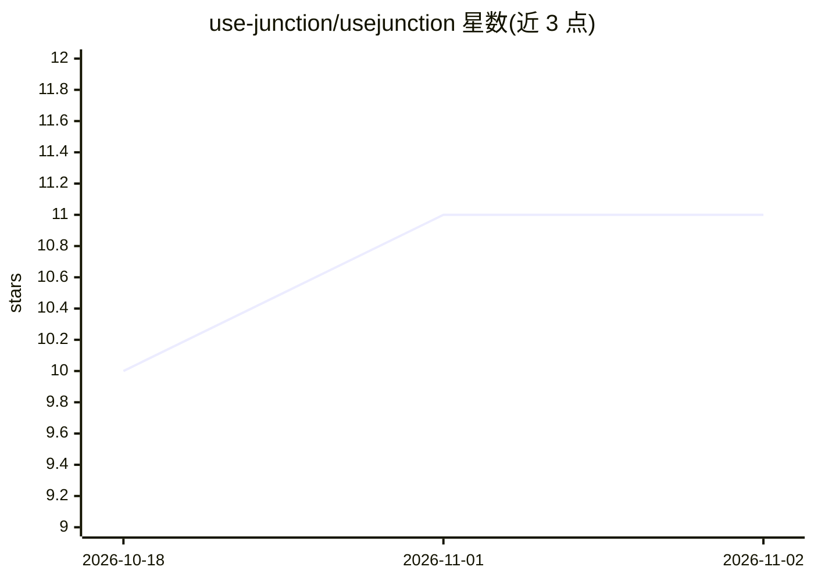

# use-junction/usejunction

⭐ 11 · TypeScript · NOASSERTION · 推送 2026-10-28 · [GitHub](https://github.com/use-junction/usejunction) · [官网](https://usejunction.dev) · 组织维护

**工程团队的 AI 编码支出与用量管理平台**

面向工程团队的 AI 编码工具使用与成本管理产品：本地 agent 仅读取本地用量信号（无键盘记录、截屏或网络拦截），采集 Claude Code、Codex、Cursor、Copilot 等工具的使用数据，在 dashboard 中展示按人/团队/工具/模型维度的实际使用与预估成本、闲置席位、未用计划、缺覆盖设备及个人 key 与公司账号的区分。安装通过 enroll token 的 curl 脚本完成，支持 Vercel 自托管（自动创建 Postgres）。

## 筛选速览

| 维度 | 判定 | 备注 |
|---|---|---|
| AI 角色 | `ai-ecosystem` | LLM/agent 周边工具 |
| 许可风险 | `none` | NOASSERTION |
| 部署形态 | `None` |  |
| 模型依赖 | — | README 未给出锁定关系 |
| 硬件要求 | — | 无带数字的原话,不猜 |
| 安装摩擦 | `low` | 无编译、无系统依赖或容器化 |
| 成熟度 | — | 结构信号不足 |

## 能力要点

- 按人/团队/工具/模型统计 AI 编码工具使用与预估成本
- 识别闲置席位、未用计划与缺覆盖设备
- agent 仅读取本地用量信号，无键盘记录/截屏/网络拦截
- 支持 Vercel 自托管（自动创建 Postgres 数据库）

## 适用场景

- 查看团队各 AI 编码工具的实际使用情况与成本分布
- 发现闲置席位与未使用的订阅计划以削减支出
- 区分个人 key 与公司配发账号，核查设备覆盖情况

## 场景标签

`LLM 可观测性` · 领域:评测与运维

## 证据(README 行号)

> L3: **Cut AI coding spend. See which seats, plans, and tools your team actually uses — and stop paying for the rest.**
> L34: - Which AI coding tools and models developers actually use

## 星数曲线

2026-10-18 10 → 2026-11-02 11（+1）

---
*卡片 v1 · prompt 1.4 · 生成 2026-11-01 · 置信度 high · 依据 README sha `7043e3737361` · [字段定义](../../DATASET.md)*
