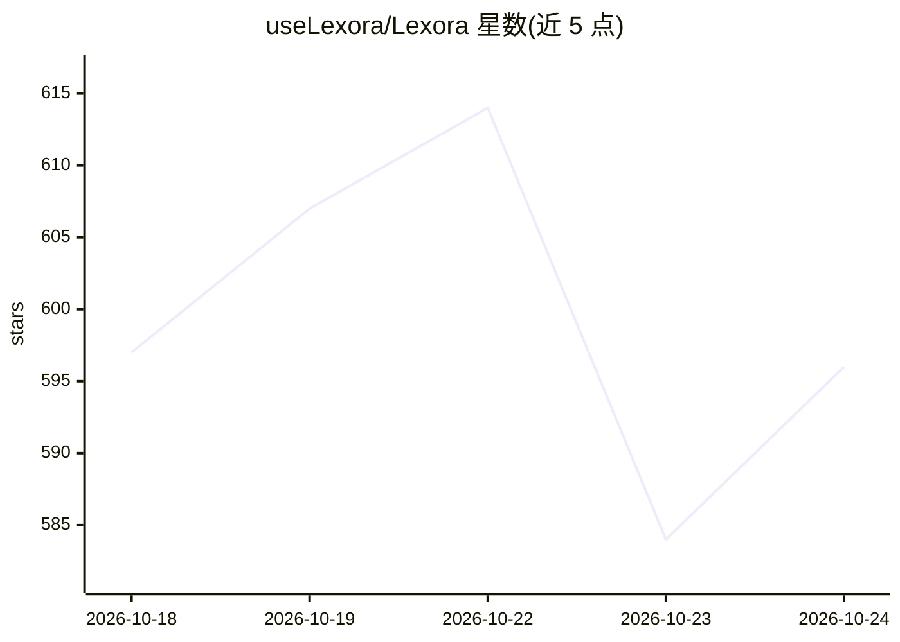

# useLexora/Lexora

⭐ 596 · TypeScript · AGPL-3.0 · 推送 2026-10-23 · [GitHub](https://github.com/useLexora/Lexora) · [官网](https://uselexora.app/) · 组织维护 · 中文 README

**面向个人用户的桌面自主 AI Agent 应用**

Lexora 是运行在 Windows、macOS、Linux 桌面上的个人 AI Agent 应用：用户以任务形式给出目标，应用安排步骤并在桌面持续推进，可整理资料、打磨创作、规划日程，支持定时自动化、对话分支、上下文引用与用量统计。采用多伙伴（agent）协作机制，可按任务为不同伙伴配置模型与行为准则。支持插件市场与通过对话生成插件，接入 MCP 服务；本地优先存储数据，模型请求由用户自行配置并直连模型服务，不内含模型额度。无需注册账号，下载安装包即可使用；本地开发需 Node.js 26+、pnpm 与 Rust 工具链。

## 筛选速览

| 维度 | 判定 | 备注 |
|---|---|---|
| AI 角色 | `ai-native` | 本体是模型或模型工具 |
| 许可风险 | `viral` | AGPL-3.0 |
| 部署形态 | `None` |  |
| 模型依赖 | — | README 未给出锁定关系 |
| 硬件要求 | — | 无带数字的原话,不猜 |
| 安装摩擦 | `low` | 无编译、无系统依赖或容器化 |
| 成熟度 | — | 结构信号不足 |

## 能力要点

- 多伙伴 agent 协作与按任务配置模型
- 通过对话生成插件源码与安装包，亦可从插件市场安装
- 接入本地或远程 MCP 服务，内置按任务分级权限（只读/人工审批/智能审批/完全访问）
- 本地优先：项目文件与任务记录存于本机，模型请求直连用户配置的服务

## 适用场景

- 在桌面电脑上让 AI 持续推进资料整理、创作打磨、行程规划等任务
- 为重复性日常任务设置定时自动化并查看运行记录
- 组建多个 AI 伙伴分工协作完成一个任务
- 在不把项目数据上传云端的前提下使用远程模型服务

## 场景标签

`AI 助手` `多智能体` `GUI 自动化` · 领域:Agent 开发

## 证据(README 行号)

> L7: Lexora 是在真实桌面实践中自我演化的个人 AI Agent。它不局限于代码助手的角色，也能陪你整理资料、打磨作品、安排日常。你说出目标，它持续推进，让文字成为工作、创作与生活的起点。
> L22: 从工作中的资料整理、创作中的反复打磨，到生活里的行程规划，先说出你想完成的事。Lexora 围绕目标安排步骤，在你的桌面上持续推进，你可以随时补充要求、查看成果。
> L35:  同一任务，多位伙伴。由 Lexora 统筹，也可以点名伙伴接手，协力推进目标。

## 星数曲线

2026-10-18 597 → 2026-10-24 596（-1）

---
*卡片 v1 · prompt 1.4 · 生成 2026-10-21 · 置信度 high · 依据 README sha `559af07e995c` · [字段定义](../../DATASET.md)*
