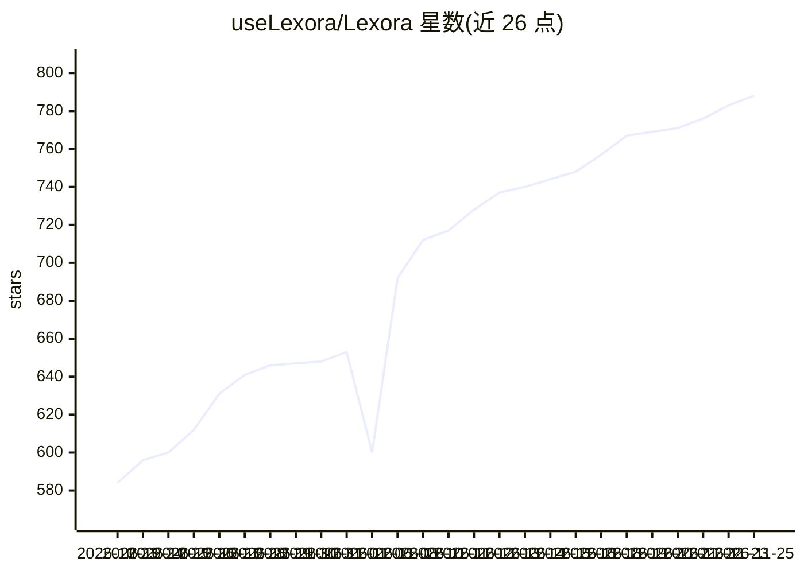

# useLexora/Lexora

⭐ 788 · TypeScript · AGPL-3.0 · 推送 2026-11-23 · [GitHub](https://github.com/useLexora/Lexora) · [官网](https://uselexora.app/) · 组织维护 · 中文 README

**本地优先的桌面个人 AI Agent：围绕目标持续推进任务**

面向个人用户的桌面 AI Agent 应用，覆盖 Windows、macOS、Linux。用户说出目标后由 Agent 安排步骤并持续执行，对话与执行记录保留在任务中可续接。能力包括多伙伴/NPC 协作、Office 文档处理与段落级引用修改、代码排查与命令执行、语音输入朗读、MCP 接入、Skills 复用、权限分级控制与用量统计。支持插件市场及由对话生成插件的机制；本地模型插件可浏览 Hugging Face 模型并在本机完成对话与生图。需自行连接模型服务，产品不含模型额度。

## 筛选速览

| 维度 | 判定 | 备注 |
|---|---|---|
| AI 角色 | `ai-native` | 本体是模型或模型工具 |
| 许可风险 | `viral` | AGPL-3.0 |
| 部署形态 | `None` |  |
| 模型依赖 | — | README 未给出锁定关系 |
| 硬件要求 | — | 无带数字的原话,不猜 |
| 安装摩擦 | `low` | 无编译、无系统依赖或容器化 |
| 成熟度 | — | 结构信号不足 |

## 能力要点

- 多伙伴与专业 NPC 协作，串联构思、研究、执行与审查
- 本地模型插件支持浏览 Hugging Face 模型并在本机推理
- 插件市场及对话生成插件源码与安装包的扩展机制
- 按任务选择只读、人工审批、智能审批或完全访问权限

## 适用场景

- 让 Agent 围绕写作或创作目标持续整理资料与打磨内容
- 用 Office 插件对照文档段落提出修改要求
- 排查项目问题、执行命令并跟进 GitHub 拉取请求
- 通过本地模型在本机完成对话与图片生成

## 场景标签

`AI 助手` `多智能体` `编码 Agent` `图像生成` · 领域:Agent 开发

## 证据(README 行号)

> L7: Lexora 是在真实桌面实践中自我演化的个人 AI Agent。它不局限于代码助手的角色，也能陪你整理资料、打磨作品、安排日常。你说出目标，它持续推进，让文字成为工作、创作与生活的起点。
> L22: 从工作中的资料整理、创作中的反复打磨，到生活里的行程规划，先说出你想完成的事。Lexora 围绕目标安排步骤，在你的桌面上持续推进，你可以随时补充要求、查看成果。
> L27:  通过本地模型插件搜索、下载和管理模型，按需准备对话、识图、语音与生图能力。

## 星数曲线

2026-10-23 584 → 2026-11-25 788（+204）

---
*卡片 v1 · prompt 1.4 · 生成 2026-11-24 · 置信度 high · 依据 README sha `cd8ccd273c81` · [字段定义](../../DATASET.md)*
