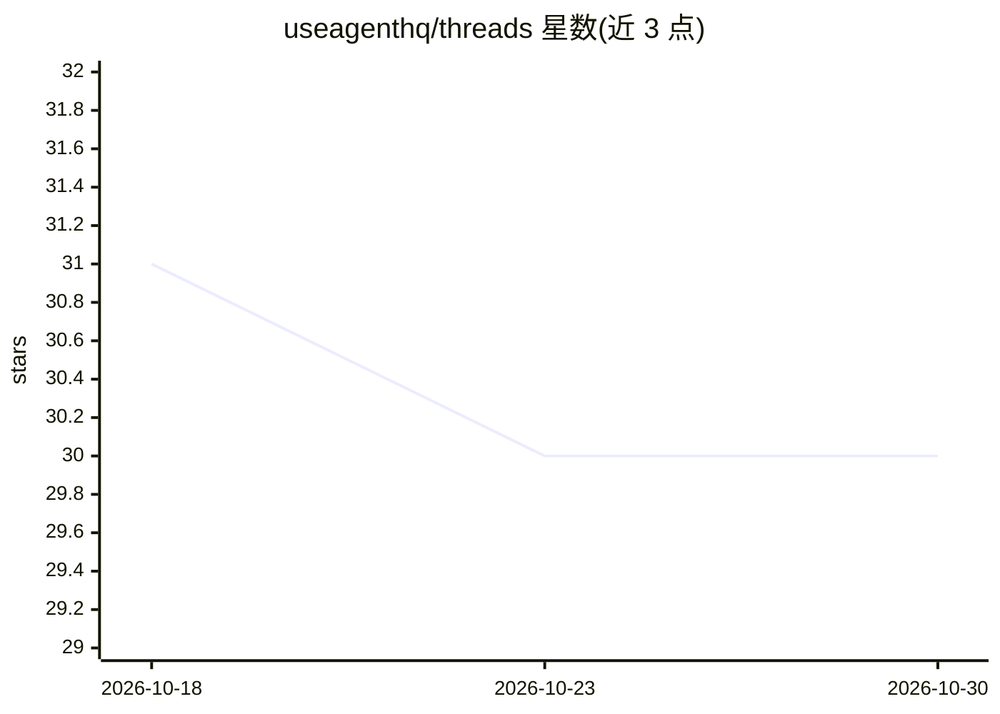

# useagenthq/threads

⭐ 30 · Python · Apache-2.0 · 推送 2026-09-29 · [GitHub](https://github.com/useagenthq/threads) · [官网](https://threadsai.dev) · 组织维护

**基于追加式事件日志的 TypeScript/Python agent 框架**

面向开发者的 agent 框架，核心机制是把每次运行写入只追加、哈希链式的事件日志，据此提供逐步回放、崩溃后续跑（不重复副作用）、从历史步骤分叉、以及把真实回合保存为回归测试用例并在 CI 离线重放。agent 在无凭证、默认无网络的沙箱（E2B/Daytona/Modal）中运行代码，内置 Slack/WhatsApp/GitHub 通道、记忆、权限钩子与 MCP 支持。模型接入 Anthropic、OpenAI、LiteLLM 等。当前为 alpha，未发布 npm/PyPI，需从源码构建，需 Bun 或 uv+Python3.12+。

## 筛选速览

| 维度 | 判定 | 备注 |
|---|---|---|
| AI 角色 | `ai-ecosystem` | LLM/agent 周边工具 |
| 许可风险 | `permissive` | Apache-2.0 |
| 部署形态 | `library` | 以包/库形式分发 |
| 模型依赖 | locked-api |  |
| 硬件要求 | — | 无带数字的原话,不猜 |
| 安装摩擦 | `low` | 无编译、无系统依赖或容器化 |
| 成熟度 | `idea` | |

## 能力要点

- 只追加哈希链事件日志，支持回放/续跑/分叉/审计
- 保存真实回合为回归用例，CI 中离线重放无需 API key
- 沙箱默认无网络无凭证，密钥经 secret() 不进日志与沙箱
- TypeScript 与 Python 遵循同一 spec，日志格式互通

## 适用场景

- 构建可审计、可回放调试的 LLM agent
- 崩溃后安全续跑并避免重复副作用
- 用真实运行回合生成回归测试并在 CI 检查

## 场景标签

`Agent 框架` · 领域:Agent 开发

## 证据(README 行号)

> L3:  An agent framework for TypeScript and Python, built on an append-only event log.
> L17: Every run of a threads agent is written to a log as it happens. From that one record you can replay the run step by
> L52:  Every run is a log: thread_started, user_input, model_request, model_response, tool_call, permission_decision, too

## 星数曲线

2026-10-18 31 → 2026-10-30 30（-1）

---
*卡片 v1 · prompt 1.4 · 生成 2026-10-26 · 置信度 mid · 依据 README sha `555746ed56cc` · [字段定义](../../DATASET.md)*
