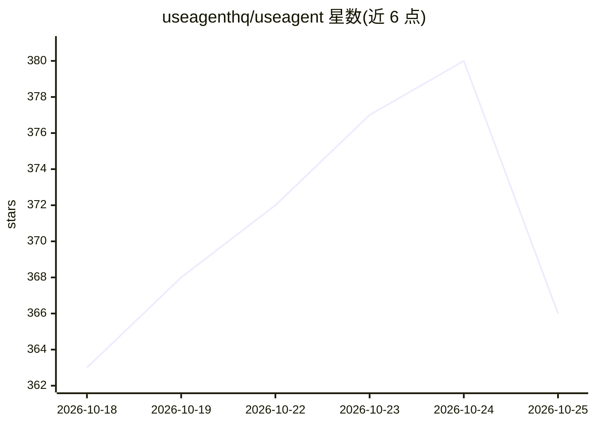

# useagenthq/useagent

⭐ 366 · TypeScript · AGPL-3.0 · 推送 2026-10-25 · [GitHub](https://github.com/useagenthq/useagent) · [官网](https://app.useagent.org) · 组织维护

**开源 Devin 替代：在可自托管的隔离工作区运行 Claude Code 等编码代理**

面向团队的 AI 编码代理运行平台：为 Claude Code、Codex、OpenCode、Pi 提供统一的共享工作区（仓库、终端、浏览器、文件），通过 Web、Slack、API 下发任务并收回 PR 与产出物。关键机制包括：每线程独立沙箱（Daytona/CubeSandbox/Box 插件式）、Postgres 只追加事件日志支持回放与恢复、引擎适配器统一事件格式可换引擎保留会话、密钥经可信网关留在控制平面。需自备 bun 与 Postgres 16+（含 pgvector），代理任务另需沙箱与模型 key。自我声明 alpha 状态，API 与 schema 可能变更。

## 筛选速览

| 维度 | 判定 | 备注 |
|---|---|---|
| AI 角色 | `ai-ecosystem` | LLM/agent 周边工具 |
| 许可风险 | `viral` | AGPL-3.0 |
| 部署形态 | `self-host` | docker 或自建部署 |
| 模型依赖 | locked-api |  |
| 硬件要求 | — | 无带数字的原话,不猜 |
| 安装摩擦 | `low` | 无编译、无系统依赖或容器化 |
| 成熟度 | `idea` | |

## 能力要点

- 支持 Claude Code、Codex、OpenCode、Pi 四种引擎，统一事件格式可切换
- Postgres 事件日志：每步可回放、审批可审计、重启后可恢复
- 自托管于任意 Linux 主机，凭据不进入代理沙箱
- 通过 Slack、邮件、REST API、CLI、MCP 多渠道下发任务

## 适用场景

- 团队用自有账号和 API key 运行 AI 编码代理做代码修改与研究
- 在自有服务器上托管代理工作区以满足合规要求
- 从 Slack 直接派发任务并接收 PR 和文件产出

## 场景标签

`编码 Agent` `Agent 框架` · 领域:Agent 开发

## 证据(README 行号)

> L19: UseAgent gives Claude Code, Codex, OpenCode and Pi a shared workspace with
> L193:  UseAgent architecture: channels enter one run API on a self-hosted control plane with a Postgres event log and en
> L197: 1. **The engine is a plug.** Every engine speaks one event format through its

## 星数曲线

2026-10-18 363 → 2026-10-25 366（+3）

---
*卡片 v1 · prompt 1.4 · 生成 2026-10-21 · 置信度 high · 依据 README sha `d4b6a0a395f3` · [字段定义](../../DATASET.md)*
