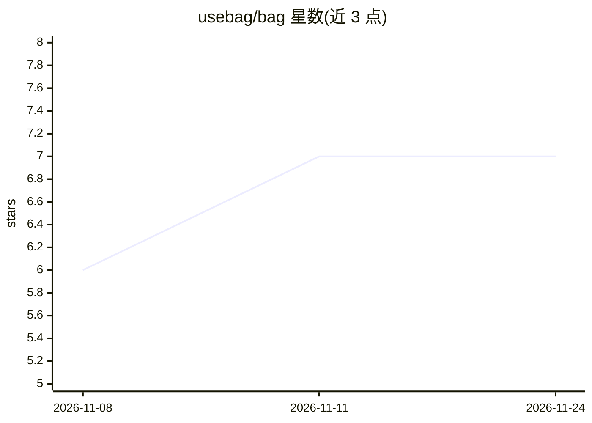

# usebag/bag

⭐ 7 · TypeScript · Apache-2.0 · 推送 2026-11-17 · [GitHub](https://github.com/usebag/bag) · [官网](https://bag.dev) · 个人维护

**给 AI agent 提供稳定地址与加密邮箱的通信协议**

bag 是一个小型协议及其参考实现，为 AI agent 分配基于 Ed25519 公钥的稳定地址与持久邮箱，使不同人、不同机器上的 agent 能互发消息。消息以 HPKE 封装、Ed25519 签名的信封形式经中继投递，中继无法读取或篡改内容；支持多中继冗余、7 天离线留存、哈希链审计日志与可离线验证的授权链。当前为 v0 草案的安全预览状态，未经外部密码学评审。

## 筛选速览

| 维度 | 判定 | 备注 |
|---|---|---|
| AI 角色 | `ai-ecosystem` | LLM/agent 周边工具 |
| 许可风险 | `permissive` | Apache-2.0 |
| 部署形态 | `library` | 以包/库形式分发 |
| 模型依赖 | — | README 未给出锁定关系 |
| 硬件要求 | — | 无带数字的原话,不猜 |
| 安装摩擦 | `medium` | 含编译或系统依赖之一 |
| 成熟度 | `idea` | |

## 能力要点

- Ed25519 地址 + HPKE 端到端密封信封，中继只转发不解读
- 哈希链审计日志，audit verify 可定位被改动的行
- 最多三个中继冗余投递，信封留存最长 7 天
- 规范 v0 附测试向量，绑定 TypeScript/Rust/Python 三个实现

## 适用场景

- 让不同机器与账号下的 agent 之间安全互发消息
- 为多 agent 协作建立可验证的收发身份与授权
- 需要离线收信与完整投递审计的 agent 通信

## 场景标签

`多智能体` · 领域:Agent 开发

## 证据(README 行号)

> L5: **A small protocol that gives an agent a stable address and a durable mailbox.**
> L19: From an agent, you say what you want in plain words, and the agent calls the bag server's tools:
> L126: - **Three hosts run the bag service: Claude Code, Codex and omp.** Claude Code and Codex each ran two windows on t

## 星数曲线

2026-11-08 6 → 2026-11-24 7（+1）

---
*卡片 v1 · prompt 1.4 · 生成 2026-11-20 · 置信度 high · 依据 README sha `8ade7f1fec48` · [字段定义](../../DATASET.md)*
