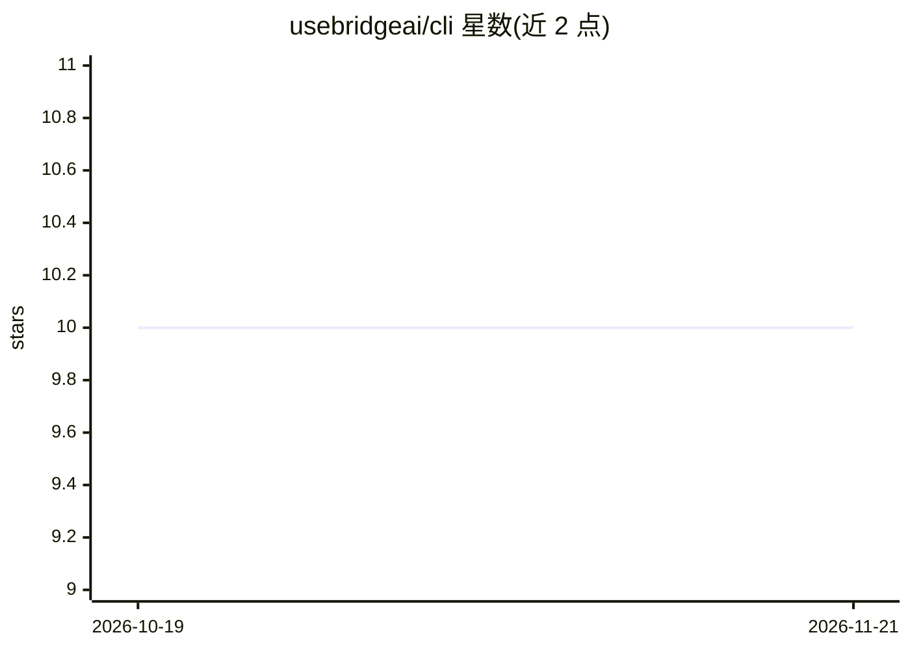

# usebridgeai/cli

⭐ 10 · Rust · NOASSERTION · 推送 2026-05-08 · [GitHub](https://github.com/usebridgeai/cli) · [官网](https://bridge.ls) · 组织维护

**让 AI agent 用统一 CLI 从任意存储读取结构化上下文**

单个 Rust 二进制的命令行工具：通过一份 bridge.yaml 配置连接文件系统、SQLite、Postgres 等存储后端，向 agent 输出 JSON（stdout 出数据、stderr 出错误）。支持 `bridge ls/read` 读取上下文、`bridge connect` 管理连接，并可从 OpenAPI 规范或数据库连接生成与托管 MCP 服务器（读取型、参数化查询、行数上限）。面向需要给 agent 提供数据上下文的开发者；限制包括 MVP 仅支持 OpenAPI 3.0 GET 操作、只读 SQL 执行。

## 筛选速览

| 维度 | 判定 | 备注 |
|---|---|---|
| AI 角色 | `ai-ecosystem` | LLM/agent 周边工具 |
| 许可风险 | `dual` | NOASSERTION |
| 部署形态 | `library` | 以包/库形式分发 |
| 模型依赖 | — | README 未给出锁定关系 |
| 硬件要求 | — | 无带数字的原话,不猜 |
| 安装摩擦 | `low` | 无编译、无系统依赖或容器化 |
| 成熟度 | — | 结构信号不足 |

## 能力要点

- 统一接口读取多种存储后端，输出 JSON 到 stdout
- 从 OpenAPI 规范或 SQL 连接生成并可托管 MCP 服务器
- 单二进制、无服务器无守护进程，扩展 provider 只需实现一个 trait
- 路径穿越防护、SQL 参数化读取、凭据脱敏等安全机制

## 适用场景

- 让 agent 框架无需为每种存储写自定义 SDK 集成代码
- 把现有 REST API 或数据库暴露为 MCP 服务器供 Claude Desktop、Cursor 等客户端使用
- 为团队托管一个基于 Streamable HTTP 的共享 MCP 端点

## 场景标签

 · 领域:AI 基础设施/数据接入

## 证据(README 行号)

> L13: Bridge gives AI agents a single interface to read structured context from any storage backend. One config file, one
> L105: **...use MCP servers?** MCP servers run inside the agent's token loop. Every tool call costs tokens. Bridge runs o
> L19: Bridge is the `rclone` for agent context. One interface, any storage, structured JSON that any framework can consum

## 星数曲线

2026-10-19 10 → 2026-11-21 10（+0）

---
*卡片 v1 · prompt 1.4 · 生成 2026-11-19 · 置信度 high · 依据 README sha `f2cbe52458b0` · [字段定义](../../DATASET.md)*
