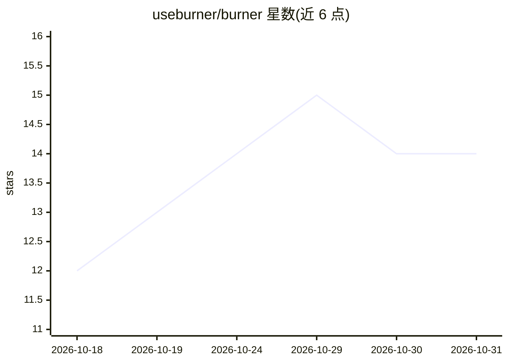

# useburner/burner

⭐ 14 · Python · MIT · 推送 2026-10-09 · [GitHub](https://github.com/useburner/burner) · [官网](https://useburner.si) · 个人维护

**让 AI 助手通过闲置安卓手机操作真实应用的命令行工具**

burner 是一个由 AI 助手运行的命令行工具：通过 Android 无线调试经 Tailscale 或家庭 Wi-Fi 连接一部闲置安卓手机，读取屏幕、点击、输入、打开应用与截图，让助手代为使用手机上的应用（购物、社交通讯、蓝牙设备控制等）。无需 burner 账号或服务器，购买、发送、发布操作均需用户确认。目前配合 Muse 作为 AI 助手使用，安装方式为让助手读取 SKILL.md 引导配置。

## 筛选速览

| 维度 | 判定 | 备注 |
|---|---|---|
| AI 角色 | `ai-ecosystem` | LLM/agent 周边工具 |
| 许可风险 | `permissive` | MIT |
| 部署形态 | `None` |  |
| 模型依赖 | — | README 未给出锁定关系 |
| 硬件要求 | — | 无带数字的原话,不猜 |
| 安装摩擦 | `low` | 无编译、无系统依赖或容器化 |
| 成熟度 | — | 结构信号不足 |

## 能力要点

- 通过 Android 无线调试连接闲置手机，支持读屏、点击、输入、打开应用与截图
- 基于 Tailscale 私有网络访问，无 burner 账号与服务器
- 购买、消息、发布等操作需用户逐次确认
- 提供 SKILL.md 完整安装步骤与命令参考

## 适用场景

- 让 AI 助手代管闲置手机上的应用（外卖、社交通讯、购物比价）
- 出差或度假时让助手维护手机上的日常事务
- 通过手机蓝牙与家庭 Wi-Fi 控制家中设备

## 场景标签

`GUI 自动化` · 领域:效率与自动化

## 证据(README 行号)

> L10: It lets your AI assistant use a spare Android phone that sits in a drawer at
> L133: burner is a small command-line tool that your AI assistant runs. It

## 星数曲线

2026-10-18 12 → 2026-10-31 14（+2）

---
*卡片 v1 · prompt 1.4 · 生成 2026-10-31 · 置信度 high · 依据 README sha `a7359c8a711e` · [字段定义](../../DATASET.md)*
