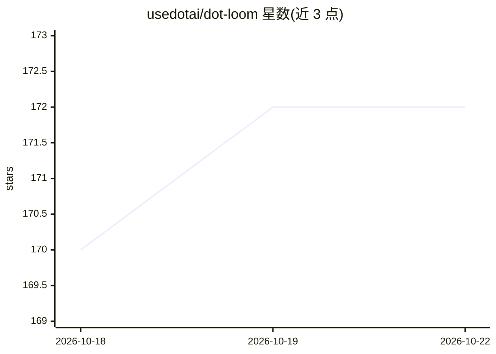

# usedotai/dot-loom

⭐ 172 · JavaScript · MIT · 推送 2026-07-16 · [GitHub](https://github.com/usedotai/dot-loom) · [官网](https://app.usedot.xyz) · 组织维护

**面向开发者的多模型自适应推理编排运行时**

Dot Loom 是一个开源、供应商可插拔的自适应推理编排运行时：针对既有请求决定调用次数与流程，提供 lean/balanced/strict/fixed 四种计算策略，按风险选择性购买验证调用，并对每次运行输出策略、调用预算、升级原因、成本、延迟、token 与回执。支持 Dot、OpenAI 兼容端点、Ollama、LM Studio 兼容本地服务器与确定性 mock 作为后端。附带可复现评测、盲评模型判分、HTML/SVG/Markdown/JSON 报告、Studio UI，以及用 Ministral 14B 训练的 conductor 路由研究轨道。自我声明为 testable alpha，不适用于生产替代商业多智能体系统。CLI 无运行时依赖，需 Node.js 20+。

## 筛选速览

| 维度 | 判定 | 备注 |
|---|---|---|
| AI 角色 | `ai-ecosystem` | LLM/agent 周边工具 |
| 许可风险 | `permissive` | MIT |
| 部署形态 | `None` |  |
| 模型依赖 | local-ok | 支持本地模型 |
| 硬件要求 | — | 无带数字的原话,不猜 |
| 安装摩擦 | `low` | 无编译、无系统依赖或容器化 |
| 成熟度 | `idea` | |

## 能力要点

- lean/balanced/strict/fixed 四种自适应计算策略与选择性验证升级
- 供应商抽象层支持 Dot、OpenAI 兼容 API、Ollama、LM Studio 兼容本地服务器与 mock
- 可复现评测：策略盲评判分、置信区间、调用/升级率与多格式报告
- 基于 Ministral 14B LoRA 的 conductor 路由研究，含 1,200 例留出基准与运行时守卫

## 适用场景

- 在高风险任务上为 LLM 调用设定质量目标与成本上限
- 对比不同计算策略/模型的成本、延迟与质量并生成可分享报告
- 在本地 Ollama 或 OpenAI 兼容端点上运行多角色编排流程

## 场景标签

 · 领域:LLM 基础设施/推理编排

## 证据(README 行号)

> L9: Dot Loom is an open, provider-pluggable adaptive inference runtime. Its default policy answers directly, then select
> L51: - Provider abstraction for Dot, OpenAI-compatible APIs, Ollama, and mock runs.

## 星数曲线

2026-10-18 170 → 2026-10-22 172（+2）

---
*卡片 v1 · prompt 1.4 · 生成 2026-10-22 · 置信度 high · 依据 README sha `900e89f8a0ac` · [字段定义](../../DATASET.md)*
