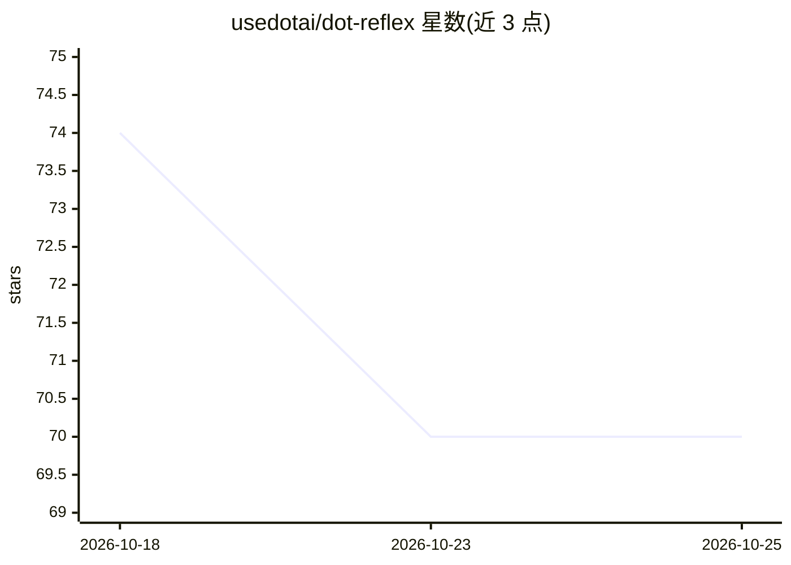

# usedotai/dot-reflex

⭐ 70 · Python · Apache-2.0 · 推送 2026-08-28 · [GitHub](https://github.com/usedotai/dot-reflex) · [官网](https://huggingface.co/usedot/Dot-Reflex-14B) · 组织维护

**AI agent 执行恢复控制器：读取轨迹返回十种控制决策**

面向编码与工具调用 agent 的监督层：读取轨迹摘要 JSON，输出 continue/verify/replan/rollback/switch_model/ask_human 等十种控制决策之一及理由。本体是 Qwen3-14B-Base 上的 rank-64 QLoRA 适配器（约 1.03GB，权重托管于 Hugging Face），可置于 GPT/Claude/Gemini/Qwen/Llama 等模型构建的 agent 旁。提供 Python CLI 与本地 FastAPI 服务。限制：训练与基准均为合成数据，参考运行时需 NVIDIA GPU（24GB 起步）与 Linux，不含 GGUF/Ollama/MLX/CPU 版本。

## 筛选速览

| 维度 | 判定 | 备注 |
|---|---|---|
| AI 角色 | `ai-ecosystem` | LLM/agent 周边工具 |
| 许可风险 | `permissive` | Apache-2.0 |
| 部署形态 | `library` | 以包/库形式分发 |
| 模型依赖 | — | README 未给出锁定关系 |
| 硬件要求 | — | 无带数字的原话,不猜 |
| 安装摩擦 | `low` | 无编译、无系统依赖或容器化 |
| 成熟度 | `idea` | |

## 能力要点

- 读取轨迹 JSON，返回十种机器可读控制决策
- Qwen3-14B-Base 上的 rank-64 4-bit NF4 QLoRA 适配器
- 贪心确定性生成，非法输入/输出时非零退出以便故障关闭
- 提供本地 uvicorn HTTP 服务与 LangGraph/OpenAI Agents SDK 等集成示例

## 适用场景

- 在编码 agent 的证据关卡处检测虚假完成并触发恢复动作
- 长任务或多模型路由中决定回滚、分支或切换模型
- 人在回路的系统里通过 ask_human 决策暂停请求输入

## 场景标签

`Agent 框架` · 领域:Agent 开发

## 证据(README 行号)

> L9: **Dot Reflex is an execution-recovery controller, not a replacement for the
> L18: another model. Dot Reflex supervises the **execution loop**, so the worker model
> L56: An NVIDIA GPU and Linux are required by the reference 4-bit runtime. A 24 GB GPU

## 星数曲线

2026-10-18 74 → 2026-10-25 70（-4）

---
*卡片 v1 · prompt 1.4 · 生成 2026-10-24 · 置信度 high · 依据 README sha `feeb93d56cc0` · [字段定义](../../DATASET.md)*
