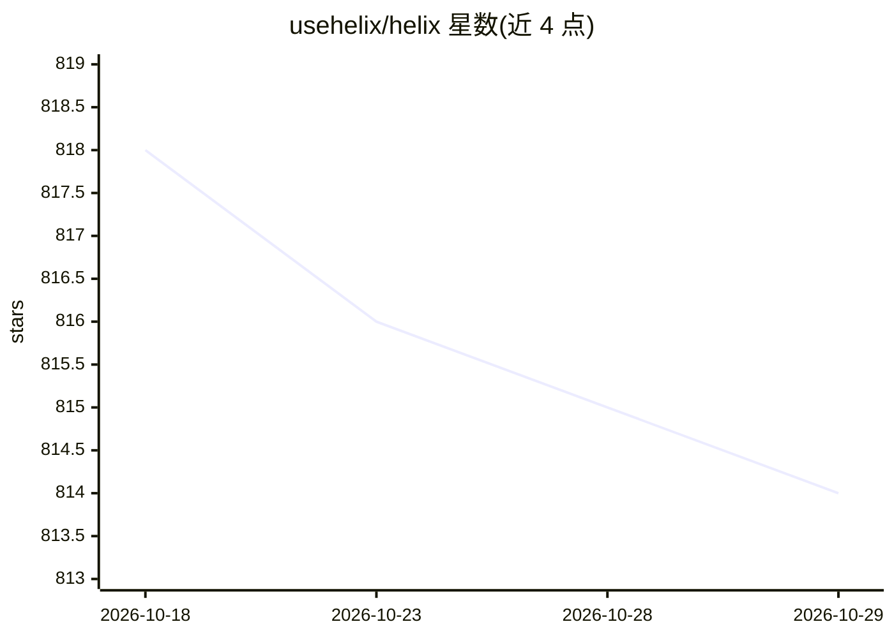

# usehelix/helix

⭐ 814 · TypeScript · MIT · 推送 2026-06-09 · [GitHub](https://github.com/usehelix/helix) · [官网](https://tryhelix.dev/) · 个人维护

**自主 agent 的自愈运行时：支付/API 调用失败自动诊断修复**

面向自主 agent 开发者的 TypeScript/Python 自愈运行时，基于 VialOS Runtime。通过 wrap() 包裹任意异步函数，失败时触发 6 阶段修复管线（感知-构造-评估-提交-验证-记忆），修复方案存入基于 SQLite 与强化学习评分的 Gene Map，重复错误可在 1ms 内免 LLM 调用修复。内置 Coinbase/Tempo/Privy/通用 HTTP 平台适配器，提供 observe/auto/full 三种风险模式、7 项安全约束与 REST API、CLI、Docker 镜像。MIT 许可。

## 筛选速览

| 维度 | 判定 | 备注 |
|---|---|---|
| AI 角色 | `ai-ecosystem` | LLM/agent 周边工具 |
| 许可风险 | `permissive` | MIT |
| 部署形态 | `self-host` | docker 或自建部署 |
| 模型依赖 | — | README 未给出锁定关系 |
| 硬件要求 | — | 无带数字的原话,不猜 |
| 安装摩擦 | `low` | 无编译、无系统依赖或容器化 |
| 成熟度 | — | 结构信号不足 |

## 能力要点

- wrap() 一行包裹函数，6 阶段自愈管线自动诊断修复失败
- Gene Map（SQLite + 强化学习）使重复错误在 1ms 内免 LLM 调用修复
- 61 种错误模式（40 支付 + 21 API）、12 种修复策略、7 项安全约束
- 提供 npm/PyPI/Docker/REST API/CLI（含代码库扫描）多种接入方式

## 适用场景

- agent 支付调用失败时自动修复并记忆，避免反复付费重试
- 包裹任意 API 调用实现自动诊断与参数修复重试
- 在 CI/CD 中扫描代码库的错误模式

## 场景标签

`Agent 框架` `Agent 记忆` · 领域:Agent 开发

## 证据(README 行号)

> L10: **Self-healing runtime for autonomous agents. Fix once, immune forever.**
> L12: **Agent payment intelligence** — predict costs, optimize execution, fix failures. Powered by VialOS Runtime.
> L73: Helix is the first vertical product of **VialOS** — an AI agent operating system. The VialOS Runtime provides the P

## 星数曲线

2026-10-18 818 → 2026-10-29 814（-4）

---
*卡片 v1 · prompt 1.4 · 生成 2026-10-21 · 置信度 high · 依据 README sha `b7b7ea0840e0` · [字段定义](../../DATASET.md)*
