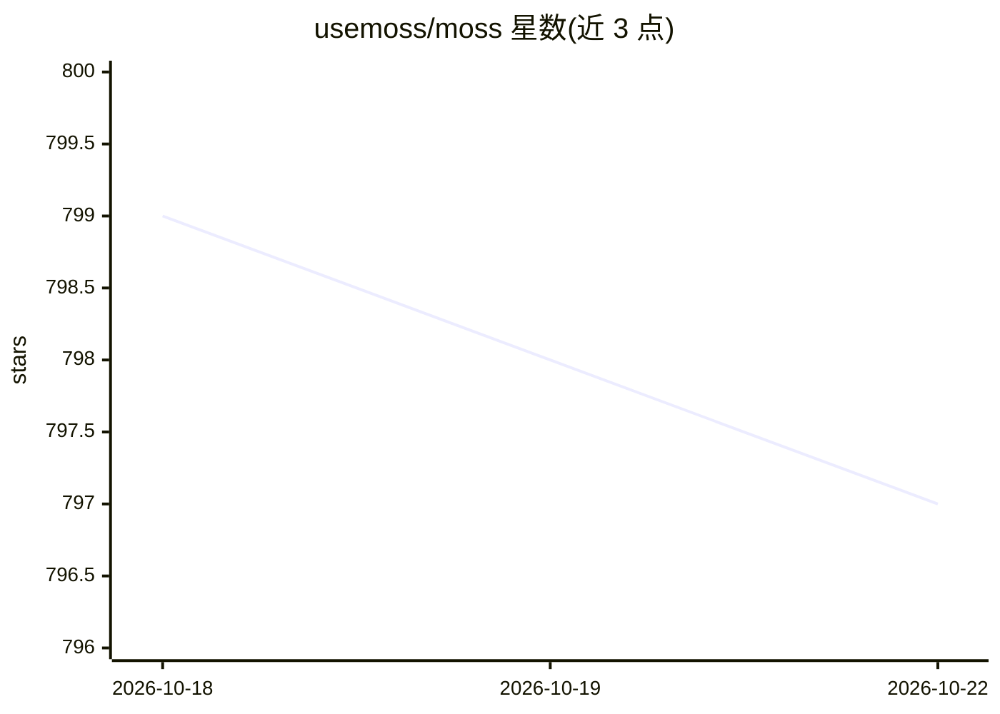

# usemoss/moss

⭐ 798 · Python · BSD-2-Clause · 推送 2026-10-22 · [GitHub](https://github.com/usemoss/moss) · [官网](https://moss.dev) · 组织维护

**面向 AI agent 的嵌入式语义检索运行时，亚 10ms 混合搜索**

Moss 是嵌入应用进程内的语义检索运行时，为对话式 AI agent 提供语义+关键词混合搜索、内置 embedding 模型、元数据过滤（$eq/$and/$in/$near），有 Python/TypeScript/Elixir/C SDK 及浏览器端 WebAssembly 构建。架构分三部分：Moss Cloud 负责摄取、embedding 与索引分发，运行时通过 HTTPS 拉取索引后在本地内存中服务查询。使用需在 moss.dev 注册获取 project_id/project_key（有免费层）。仓库主体为 BSD 2-Clause，同步发布的 SDK 采用 PolyForm Shield License。提供 LangChain、LlamaIndex、Pipecat 等约 20 项框架集成与 CLI。

## 筛选速览

| 维度 | 判定 | 备注 |
|---|---|---|
| AI 角色 | `ai-ecosystem` | LLM/agent 周边工具 |
| 许可风险 | `permissive` | BSD-2-Clause |
| 部署形态 | `self-host` | docker 或自建部署 |
| 模型依赖 | local-ok | 支持本地模型 |
| 硬件要求 | — | 无带数字的原话,不猜 |
| 安装摩擦 | `low` | 无编译、无系统依赖或容器化 |
| 成熟度 | — | 结构信号不足 |

## 能力要点

- 混合检索（语义+关键词）与内置 embedding 模型，无需 OpenAI key
- 浏览器端 WebAssembly SDK（@moss-dev/moss-web）可完全客户端运行
- SQLite/MongoDB/MySQL/Supabase 数据库连接器直接摄取
- 约 20 项框架集成（LangChain、LlamaIndex、Pipecat、LiveKit、n8n 等）与 CLI

## 适用场景

- 为语音 agent 或 copilot 提供低延迟检索层
- 在浏览器或离线优先应用中做客户端语义搜索
- 用 Ollama + Pipecat 组合搭建全本地运行的语音 agent

## 场景标签

 · 领域:AI 检索基础设施/RAG

## 证据(README 行号)

> L12: Moss is a sub-10 ms semantic search runtime built for Conversational AI agents. Hybrid retrieval (semantic + Keywor
> L14: No network hop on the hot path. No clusters to tune. Point the SDK at Moss Cloud, load your index, and query it in 
> L176: - **Runtime** - embedded in your application. It pulls indexes over HTTPS, holds them in memory, and serves querie

## 星数曲线

2026-10-18 799 → 2026-10-22 797（-2）

---
*卡片 v1 · prompt 1.4 · 生成 2026-10-21 · 置信度 mid · 依据 README sha `b79931a4e5b6` · [字段定义](../../DATASET.md)*
