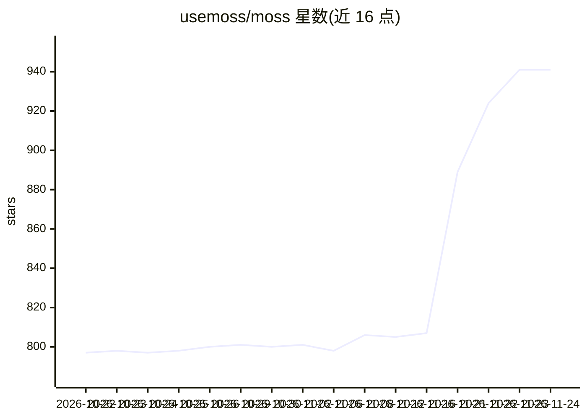

# usemoss/moss

⭐ 989 · Python · BSD-2-Clause · 推送 2026-11-23 · [GitHub](https://github.com/usemoss/moss) · [官网](https://moss.dev) · 组织维护

**给实时 AI agent 用的亚 10ms 进程内语义检索运行时**

Moss 是面向对话式 AI agent 的语义搜索运行时：混合检索（语义+关键词）、内置嵌入模型、元数据过滤，SDK 嵌入应用进程内运行，查询不经网络跳转。索引托管在 Moss Cloud（需注册 project_id/project_key），运行时通过 HTTPS 拉取索引并在本地内存中响应查询。提供 Python/TypeScript/Elixir/C SDK 与浏览器端 WebAssembly 构建、CLI、数据库连接器及大量框架集成示例。SDK 部分采用 PolyForm Shield 许可，其余为 BSD 2-Clause。

## 筛选速览

| 维度 | 判定 | 备注 |
|---|---|---|
| AI 角色 | `ai-ecosystem` | LLM/agent 周边工具 |
| 许可风险 | `permissive` | BSD-2-Clause |
| 部署形态 | `self-host` | docker 或自建部署 |
| 模型依赖 | local-ok | 支持本地模型 |
| 硬件要求 | — | 无带数字的原话,不猜 |
| 安装摩擦 | `low` | 无编译、无系统依赖或容器化 |
| 成熟度 | — | 结构信号不足 |

## 能力要点

- 查询在进程内完成，亚 10ms 延迟（基准测试 P50 3.1ms）
- 内置嵌入模型，无需外部 embedding 服务或 API key
- WebAssembly 版本可在浏览器客户端离线运行检索
- 与 LangChain/LlamaIndex/Pipecat/LiveKit/Vapi 等框架有集成示例

## 适用场景

- 为语音对话 agent 提供低延迟 RAG 检索
- 在静态网站或浏览器扩展中做纯客户端语义搜索
- 从 SQLite/MongoDB/MySQL/Supabase 直接摄取文档建索引

## 场景标签

`语义搜索` `向量数据库` · 领域:知识与检索

## 证据(README 行号)

> L12: Moss is a sub-10 ms semantic search runtime built for Conversational AI agents. Hybrid retrieval (semantic + Keywor
> L176: - **Runtime** - embedded in your application. It pulls indexes over HTTPS, holds them in memory, and serves querie
> L182: - **Server-side** - `moss` (Python) and `@moss-js/moss` (Node.js 20+) embed the runtime in your backend. Use this 

## 星数曲线

2026-10-22 797 → 2026-11-24 941（+144）

---
*卡片 v1 · prompt 1.4 · 生成 2026-11-24 · 置信度 mid · 依据 README sha `28743180c577` · [字段定义](../../DATASET.md)*
