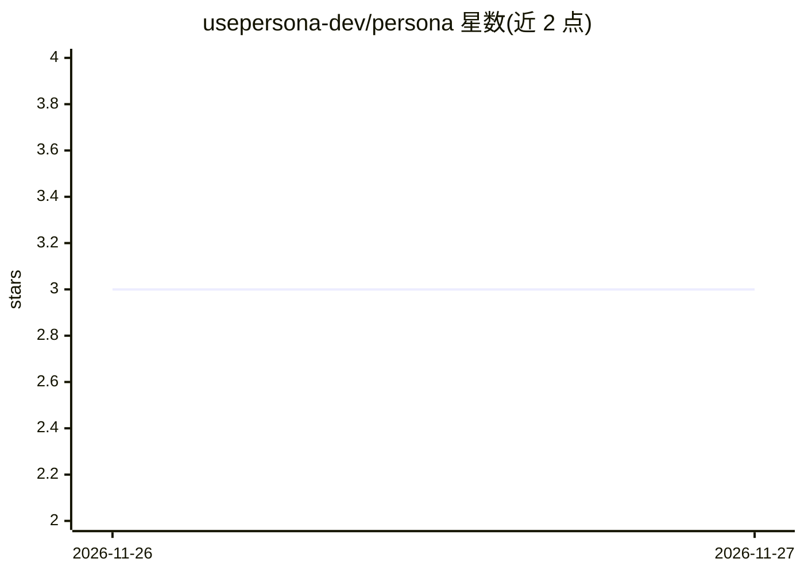

# usepersona-dev/persona

⭐ 3 · TypeScript · AGPL-3.0 · 推送 2026-11-25 · [GitHub](https://github.com/usepersona-dev/persona) · [官网](https://usepersona.dev) · 组织维护

**Agent 工厂：把带规则、技能与应用的 AI agent 部署到多渠道**

自托管的 AI agent 构建与托管平台：用户为每个 persona 配置指令规则、任务技能、定时自动化与模型路由，接入 WhatsApp/Telegram/Web 等渠道对话，并提供媒体生成、浏览器操作、记忆、加密凭据库、沙箱代码执行、MCP 工具接入与 REST API。基于 pnpm monorepo（Next.js），运行需 Node 24、pnpm、Postgres 15+、Redis 6+、Docker 及 Clerk、Composio、Supermemory 等多个外部服务账号，支持一键部署到 Vercel（Pro 团队以支持每分钟调度）。AGPL-3.0 许可。

## 筛选速览

| 维度 | 判定 | 备注 |
|---|---|---|
| AI 角色 | `ai-ecosystem` | LLM/agent 周边工具 |
| 许可风险 | `viral` | AGPL-3.0 |
| 部署形态 | `library` | 以包/库形式分发 |
| 模型依赖 | — | README 未给出锁定关系 |
| 硬件要求 | — | 无带数字的原话,不猜 |
| 安装摩擦 | `low` | 无编译、无系统依赖或容器化 |
| 成熟度 | — | 结构信号不足 |

## 能力要点

- 多渠道部署：WhatsApp 自带号码、Telegram 自带 bot、Web chat
- 模型路由：Vercel AI Gateway 多模型配置，路由模型按对话逐轮选模型
- 自动化定时任务、webhook 触发与任意 MCP server 作为工具接入
- AES-256-GCM 封存的凭据库，模型不可见密钥值

## 适用场景

- 在 WhatsApp/Telegram 上运行一个按我规则办事的个人助理
- 给不同项目配置各自的 bot 号码与自动化定时任务
- 通过 REST API 把 persona 接入我自己的系统

## 场景标签

`聊天机器人` `AI 助手` · 领域:对话与助手

## 证据(README 行号)

> L5:  The agent factory. Make AI agents with your rules, skills and apps, and put them on WhatsApp, Telegram and the web.
> L28: - **Models:** choose several models on the Vercel AI Gateway and say what each one is for. Jev, a routing model, re
> L62: You need Node 24, pnpm, Postgres 15 or later, Redis 6 or later, Docker, and an account with each service in What yo

## 星数曲线

2026-11-26 3 → 2026-11-27 3（+0）

---
*卡片 v1 · prompt 1.4 · 生成 2026-11-26 · 置信度 high · 依据 README sha `c6d54410c48a` · [字段定义](../../DATASET.md)*
