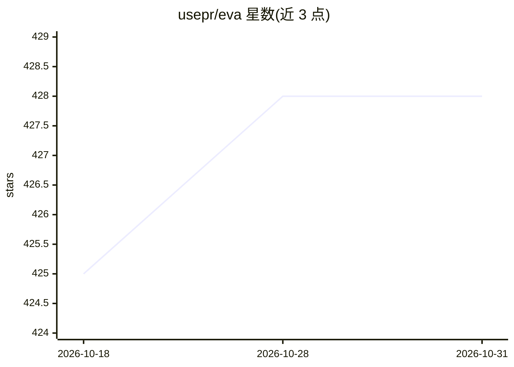

# usepr/eva

⭐ 428 · Python · MIT · 推送 2026-10-12 · [GitHub](https://github.com/usepr/eva) · 个人维护 · 中文 README

**单文件零依赖命令行 AI Agent，帮用户执行运维与脚本任务**

EVA 是一个仅由 eva.py 单文件构成的 Agent，需 Python 即可运行，面向 Linux/Windows 运维与自动化场景用户：可写脚本、写测试案例、执行 shell、分析数据。通过 OpenAI 接口形式接入 LLM，支持 DeepSeek、OpenAI 等 API，或 Ollama/vLLM 拉起的本地模型，通过三个环境变量切换。带安全审查（默认只执行读命令）、目录级 Session 延续对话，并可通过 .eva/EVA.md 进行设定与技能扩展。

## 筛选速览

| 维度 | 判定 | 备注 |
|---|---|---|
| AI 角色 | `ai-native` | 本体是模型或模型工具 |
| 许可风险 | `permissive` | MIT |
| 部署形态 | `None` |  |
| 模型依赖 | local-ok | 支持本地模型 |
| 硬件要求 | — | 无带数字的原话,不猜 |
| 安装摩擦 | `low` | 无编译、无系统依赖或容器化 |
| 成熟度 | — | 结构信号不足 |

## 能力要点

- 单文件零依赖，仅一个 eva.py，有 Python 即可运行
- 支持 OpenAI 接口形式的本地模型（Ollama/vLLM）或云端 API（DeepSeek/OpenAI）
- 安全审查：默认只执行读命令，其他命令需确认
- 目录级 Session：同目录启动延续之前对话

## 适用场景

- 在运维/自动化流程中以单命令方式调用 Agent 完成任务
- 本地模型环境下做脚本编写、shell 执行与数据分析
- 通过 EVA.md 设定与技能文件扩展 Agent 行为

## 场景标签

`AI 助手` `编码 Agent` `数据分析` · 领域:效率与自动化

## 证据(README 行号)

> L30: EVA是个麻雀虽小、五脏俱全的Agent智能体，相当于低配版Claude Code，能帮你写脚本、写测试案例、执行shell、分析数据等。我自己就是EVA的重度用户，日常处理各种任务。
> L36: - 本地化：可以接入本地部署的OpenAI接口模型，如vLLM，或者是外网模型
> L37: - 极致轻量化：单文件，仅一个`eva.py`，有python就能运行

## 星数曲线

2026-10-18 425 → 2026-10-31 428（+3）

---
*卡片 v1 · prompt 1.4 · 生成 2026-10-21 · 置信度 high · 依据 README sha `36fb0af6075a` · [字段定义](../../DATASET.md)*
