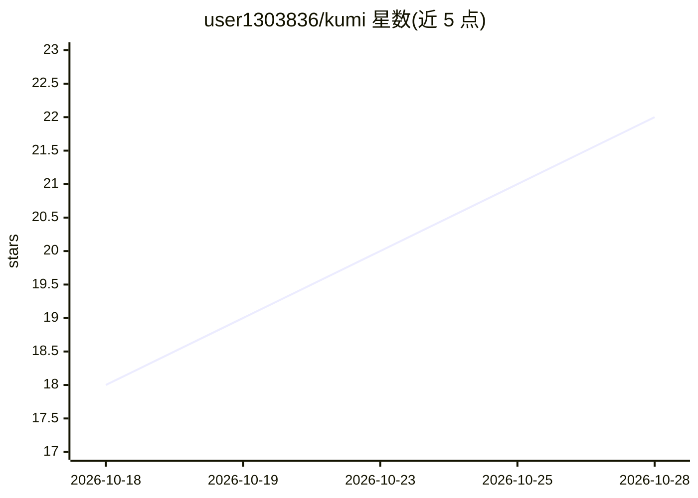

# user1303836/kumi

⭐ 23 · Rust · NOASSERTION · 推送 2026-10-28 · [GitHub](https://github.com/user1303836/kumi) · 个人维护 · 中文 README

**在 DAW 内协作的通用 AI agent：自然语言改工程**

面向 Ableton Live、REAPER、Renoise 三款 DAW 的终端聊天式 AI agent：读取工程、修改混音与编曲、本地分析音频、学习用户音色与习惯；每步变更记录在历史中并可撤销，大改动前自动备份已保存版本。可粘贴 YouTube 教程链接生成音色、匹配参考曲目、构建 Max for Live 设备、对采样库做相似度映射与调色板管理。需要代码时自行编写并运行（Live 用 Python，REAPER/Renoise 用 Lua）。模型可选 ChatGPT 账号登录、API key（Anthropic/OpenAI/Gemini/OpenRouter 等 20 余家）或本地 Ollama/LM Studio/llama.cpp/vLLM，本地路径需能跑约 57k 上下文的工具调用模型。Rust 运行时，macOS/Windows 提供脚本安装。

## 筛选速览

| 维度 | 判定 | 备注 |
|---|---|---|
| AI 角色 | `ai-native` | 本体是模型或模型工具 |
| 许可风险 | `permissive` | NOASSERTION |
| 部署形态 | `None` |  |
| 模型依赖 | local-ok | 支持本地模型 |
| 硬件要求 | — | 无带数字的原话,不猜 |
| 安装摩擦 | `low` | 无编译、无系统依赖或容器化 |
| 成熟度 | `idea` | |

## 能力要点

- 统一支持 Ableton Live 12 / REAPER 7 / Renoise 3.5 三款 DAW
- 变更历史与撤销机制，大改动前备份已保存版本
- 音频本地分析，模型只接收测量数据
- 采样/歌曲相似度映射与调色板选取
- 支持本地模型（Ollama/LM Studio/OpenAI 兼容服务器）

## 适用场景

- 用对话让 AI 修混音、找出频率冲突并迭代验证
- 粘贴教程视频链接复刻音色或构建 Max for Live 设备
- 整理采样库：相似度分组、调色板管理与调用
- 处理改名、路由、侧链、冻结、导出等杂务

## 场景标签

`AI 助手` · 领域:对话与助手

## 证据(README 行号)

> L13: **Kumi is a general-purpose AI agent that works alongside you in your DAW.** Kumi currently supports Ableton Live, 
> L42: - **Build a sound from a tutorial.** Paste a YouTube link: Kumi watches it and builds what it shows on a new track.

## 星数曲线

2026-10-18 18 → 2026-10-28 22（+4）

---
*卡片 v1 · prompt 1.4 · 生成 2026-10-28 · 置信度 high · 依据 README sha `8ed0c8f3bd42` · [字段定义](../../DATASET.md)*
