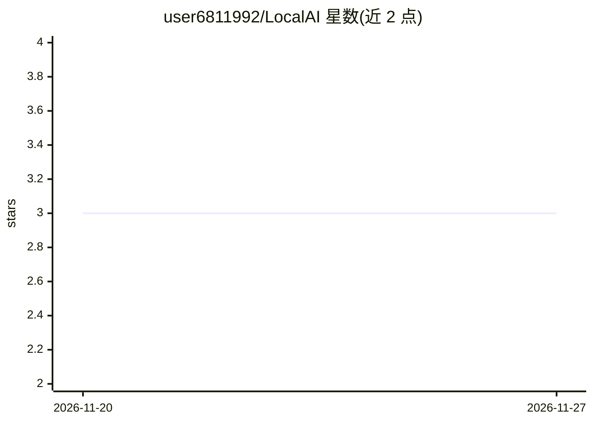

# user6811992/LocalAI

⭐ 3 · JavaScript · MIT · 推送 2026-11-20 · [GitHub](https://github.com/user6811992/LocalAI) · [官网](https://github.com/user6811992/aegisai-next) · 个人维护

**本地运行的 AI 聊天 Web UI，含模型管理与逆向工程工具**

基于 Ollama 的本地 AI Web UI，完全在本机运行、无云端与遥测。提供聊天界面、会话分支、模型管理（从 Ollama/HuggingFace 拉取模型、扫描本地 GGUF 文件）、9 个免密搜索引擎集成、STT/TTS 语音输入输出、RAG 重建索引，以及通过 REA MCP 提供的 229 个逆向工程工具（含 clean room 模式）。默认后端为 Ollama，也支持 llama.cpp、LM Studio 等任何 OpenAI 兼容端点；Windows/macOS/Linux 提供安装包，也可源码或 Docker 运行。逆向工具需单独安装 REA。

## 筛选速览

| 维度 | 判定 | 备注 |
|---|---|---|
| AI 角色 | `ai-ecosystem` | LLM/agent 周边工具 |
| 许可风险 | `permissive` | MIT |
| 部署形态 | `desktop` | 安装包/桌面程序 |
| 模型依赖 | local-ok | 支持本地模型 |
| 硬件要求 | — | 无带数字的原话,不猜 |
| 安装摩擦 | `low` | 无编译、无系统依赖或容器化 |
| 成熟度 | — | 结构信号不足 |

## 能力要点

- 完全本地运行，无遥测、无数据回传
- 多后端支持：Ollama 默认，兼容 llama.cpp/LM Studio/OpenAI 兼容端点，启动时自动探测
- 内置 229 个逆向工程工具（REA MCP），含 Deep/Clean room 两种模式
- 聊天分支、技能系统、Squeeze 长文档问答与 9 个免密搜索引擎集成

## 适用场景

- 在本机隐私环境下与本地大模型对话
- 统一管理 Ollama/HuggingFace 模型与本地 GGUF 文件
- 对二进制、Android、固件做 AI 辅助逆向分析
- 局域网或 Tailscale 内多设备访问本地 AI 界面

## 场景标签

`语音合成` `文档问答` `RAG` `聊天机器人` · 领域:对话与助手

## 证据(README 行号)

> L5: A local AI web UI powered by Ollama, with a built-in chat interface, search engine integration, model management, an
> L43:  - Ollama (default, recommended) — installed and running, **or**
> L100: By default AegisAI talks to Ollama, but the server can also drive any

## 星数曲线

2026-11-20 3 → 2026-11-27 3（+0）

---
*卡片 v1 · prompt 1.4 · 生成 2026-11-21 · 置信度 high · 依据 README sha `e09d9daea5c4` · [字段定义](../../DATASET.md)*
