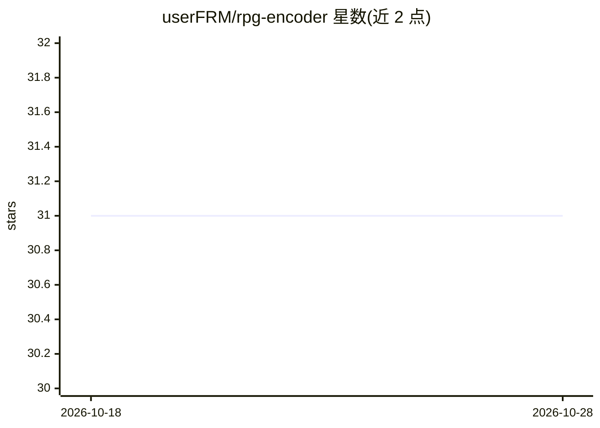

# userFRM/rpg-encoder

⭐ 31 · Rust · MIT · 推送 2026-05-29 · [GitHub](https://github.com/userFRM/rpg-encoder) · [官网](https://www.npmjs.com/package/rpg-encoder) · 个人维护

**给 AI 编程 agent 提供全仓库语义理解的 MCP server**

Rust + Tree-sitter 实现的 MCP server：对代码库建立语义图（实体、依赖边、动词-宾语特征），支持 15 种语言，通过 27 个 MCP 工具向 Claude Code、Cursor 等 agent 提供按意图搜索、依赖遍历、影响面分析、变更规划与单次全仓库语义快照（~1000 实体压缩到约 25K token）。图随 git 工作区变化自动增量同步。语义提升（lifting）可由 agent 完成，也可经 auto_lift 直接调用 Anthropic/OpenAI/OpenRouter/Gemini 等廉价外部模型（约 $0.02/100 实体）。提供 npx 预编译二进制、npm 安装与源码 cargo 构建三种方式；MIT 许可。

## 筛选速览

| 维度 | 判定 | 备注 |
|---|---|---|
| AI 角色 | `ai-ecosystem` | LLM/agent 周边工具 |
| 许可风险 | `permissive` | MIT |
| 部署形态 | `library` | 以包/库形式分发 |
| 模型依赖 | locked-api |  |
| 硬件要求 | — | 无带数字的原话,不猜 |
| 安装摩擦 | `medium` | 含编译或系统依赖之一 |
| 成熟度 | — | 结构信号不足 |

## 能力要点

- Tree-sitter 解析 15 种语言的实体与依赖，构建 3 层语义层级
- semantic_snapshot 单次调用返回约 25K token 的全仓库语义图
- git 工作区变化触发自动增量同步，含回退检测
- 27 个 MCP 工具覆盖搜索、依赖分析、影响面、变更规划与健康度检查

## 适用场景

- 让编程 agent 在回答代码结构/行为问题前先查语义图而非逐文件 grep
- 规划重构时查询影响半径与依赖路径
- 团队共享提交到仓库的 .rpg/graph.json 语义图

## 场景标签

`语义搜索` · 领域:知识与检索

## 证据(README 行号)

> L12: AI coding agents waste most of their tool calls fumbling through your codebase with `grep`, `cat`, `find`, and file
> L99:  Your codebase (15 languages) → RPG Engine (5 Rust crates: parser, encoder, nav, lift, mcp) → Clients (Claude Code,

## 星数曲线

2026-10-18 31 → 2026-10-28 31（+0）

---
*卡片 v1 · prompt 1.4 · 生成 2026-10-26 · 置信度 high · 依据 README sha `681b4790e3f4` · [字段定义](../../DATASET.md)*
