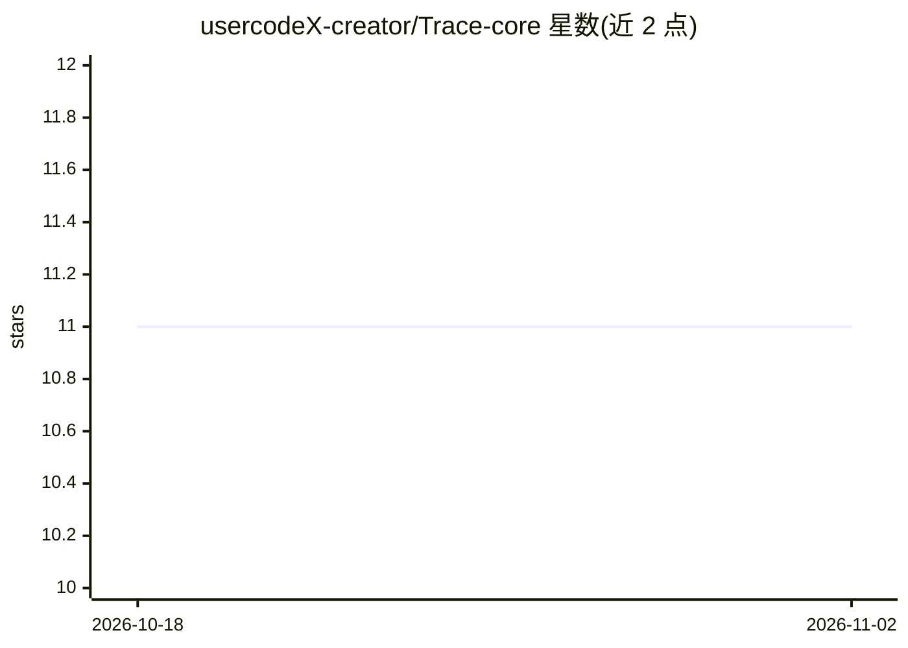

# usercodeX-creator/Trace-core

⭐ 11 · TypeScript · MIT · 推送 2026-04-26 · [GitHub](https://github.com/usercodeX-creator/Trace-core) · [官网](https://tracecheck.dev) · 个人维护

**检测 AI 生成代码 24 种典型缺陷的开源静态分析器**

面向 AI 生成代码的开源静态分析 CLI（npx trace-core），检测幻觉依赖、硬编码凭据、静默异常、同义反复测试、假类型安全等 24 种失败模式，覆盖 Python/JS/TS/Go/Rust/Ruby 六种语言（前三者覆盖最深）。通过退出码与 --json 输出接入 CI，支持 GitHub Actions 并上传 SARIF；另提供网页 Playground 展示双语修复卡片。README 声明其定位是 Snyk/Semgrep 之上的补充层而非替代，MIT 许可、无安装要求。检测基于静态规则，不含 LLM 调用。

## 筛选速览

| 维度 | 判定 | 备注 |
|---|---|---|
| AI 角色 | `ai-ecosystem` | LLM/agent 周边工具 |
| 许可风险 | `permissive` | MIT |
| 部署形态 | `library` | 以包/库形式分发 |
| 模型依赖 | — | README 未给出锁定关系 |
| 硬件要求 | — | 无带数字的原话,不猜 |
| 安装摩擦 | `low` | 无编译、无系统依赖或容器化 |
| 成熟度 | — | 结构信号不足 |

## 能力要点

- 24 个针对 LLM 代码习惯的检测器，覆盖 6 种语言
- npx 免安装运行，退出码与 --JSON 输出适配 CI
- GitHub Actions 一行集成，上传 SARIF 到 Code scanning
- 提供网页 Playground 与双语修复说明卡片

## 适用场景

- 我在 CI 里扫描 AI 生成的代码，拦截幻觉导入和假测试
- 代码评审前先用 Trace 快速检查 LLM 产出的常见缺陷
- 在浏览器粘贴代码片段查看检测项与修复建议

## 场景标签

 · 领域:开发者工具/代码安全

## 证据(README 行号)

> L12: Trace is an open-source static analyzer for AI-generated code. It detects the 24 failure patterns that only LLMs pr
> L112: Trace is not a replacement for Snyk or Semgrep. It's the layer above them. Run Snyk for CVE scanning. Run Semgrep 

## 星数曲线

2026-10-18 11 → 2026-11-02 11（+0）

---
*卡片 v1 · prompt 1.4 · 生成 2026-11-01 · 置信度 mid · 依据 README sha `ce614bec79b6` · [字段定义](../../DATASET.md)*
