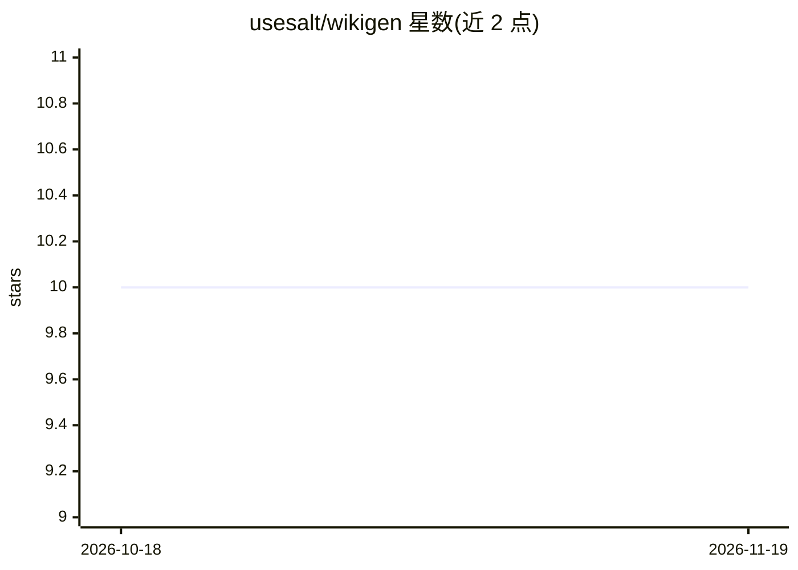

# usesalt/wikigen

⭐ 10 · Python · MIT · 推送 2026-02-07 · [GitHub](https://github.com/usesalt/wikigen) · [官网](https://usesalt.co) · 组织维护

**为代码库生成供 LLM 使用的 wiki 文档的 CLI 工具**

WikiGen（前名 salt-docs）是一个代码库文档生成器，将现有代码库转换为面向 LLM 输入的紧凑、人类可读的 wiki 表示。通过 CLI 分析 GitHub 仓库或本地目录，识别代码抽象并生成文档，支持多语言输出与抽象数量、文件过滤等选项；配置存于用户目录并通过系统 keyring 管理 API key。内置 MCP 服务器，向 Cursor、Claude Desktop 等编辑器助手暴露 list_docs/get_docs/search_docs/index_directories 工具；另含 GitHub Actions CI/CD 集成生成文档 PR。

## 筛选速览

| 维度 | 判定 | 备注 |
|---|---|---|
| AI 角色 | `ai-native` | 本体是模型或模型工具 |
| 许可风险 | `permissive` | MIT |
| 部署形态 | `library` | 以包/库形式分发 |
| 模型依赖 | local-ok | 支持本地模型 |
| 硬件要求 | — | 无带数字的原话,不猜 |
| 安装摩擦 | `low` | 无编译、无系统依赖或容器化 |
| 成熟度 | — | 结构信号不足 |

## 能力要点

- 将代码库转为面向 LLM 输入的无损紧凑 wiki 表示
- 支持 5 种 LLM provider：Gemini（默认）、OpenAI、Anthropic、OpenRouter、Ollama 本地运行
- 内置 MCP 服务器，向 Cursor / Claude Desktop 等提供文档查询工具
- GitHub Actions CI/CD 集成，自动生成文档并创建 PR

## 适用场景

- 为提交给 LLM 的代码库生成低 token 占用的结构化文档
- 在 Cursor / Claude Desktop 中通过 MCP 查询代码库文档
- 通过 CI 流水线保持文档与代码变更同步
- 用 Ollama 本地模型离线或隐私敏感场景下生成文档

## 场景标签

 · 领域:开发者工具/文档生成

## 证据(README 行号)

> L7: **WikiGen** (Previously named "salt-docs") is a compact, human-readable documentation generator for codebases that m
> L8: It's intended for **LLM input** as a drop-in, lossless representation of your existing codebase.

## 星数曲线

2026-10-18 10 → 2026-11-19 10（+0）

---
*卡片 v1 · prompt 1.4 · 生成 2026-11-19 · 置信度 high · 依据 README sha `4d3e43029956` · [字段定义](../../DATASET.md)*
