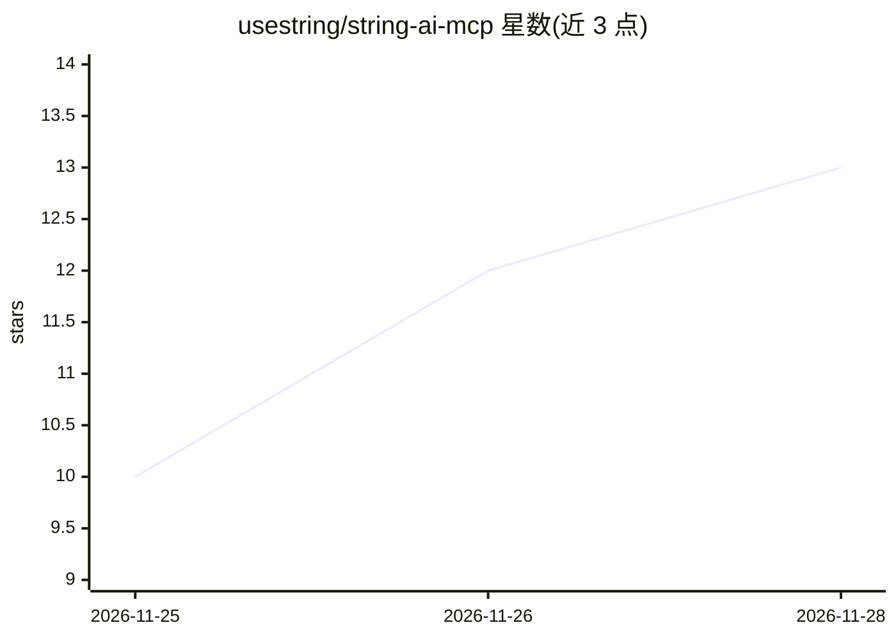

# usestring/string-ai-mcp

⭐ 13 · TypeScript · MIT · 推送 2026-11-27 · [GitHub](https://github.com/usestring/string-ai-mcp) · 组织维护

**面向 MCP 客户端提供网页抓取/搜索/站点爬取的 MCP 服务器**

String AI Web Access API 的官方 MCP 服务器：为 LLM 客户端提供网页搜索（Google 结果页多表面/多类型）、URL 抓取（返回 LLM-ready Markdown）、HTTP 请求发送、浏览器交互动作与站点爬取等工具，爬取采用报价→审批→轮询的计费生命周期。提供托管端点（无需安装，免费额度可用）与本地 npm 包（stdio，需 API key）两种运行方式，本地包额外提供余额查询与失败诊断工具。

## 筛选速览

| 维度 | 判定 | 备注 |
|---|---|---|
| AI 角色 | `ai-ecosystem` | LLM/agent 周边工具 |
| 许可风险 | `permissive` | MIT |
| 部署形态 | `library` | 以包/库形式分发 |
| 模型依赖 | — | README 未给出锁定关系 |
| 硬件要求 | — | 无带数字的原话,不猜 |
| 安装摩擦 | `low` | 无编译、无系统依赖或容器化 |
| 成熟度 | — | 结构信号不足 |

## 能力要点

- 网页搜索与 URL 抓取，返回 LLM-ready Markdown
- 托管服务器无需安装、无账号可免费使用
- 报价→审批→计费的站点爬取任务流程
- 托管与 npm 本地两种运行方式，支持多客户端配置

## 适用场景

- 让 Claude/Cursor 等 MCP 客户端读取任意网页内容
- 为 LLM 会话补充实时网页搜索结果
- 按预算对整个站点进行爬取并提取 URL

## 场景标签

`网页抓取` · 领域:效率与自动化

## 证据(README 行号)

> L3: The official Model Context Protocol (MCP) server for
> L8: ## Connect to the hosted server
> L151: The npm package runs the server on your own machine over stdio. It needs a String API key.

## 星数曲线

2026-11-25 10 → 2026-11-28 13（+3）

---
*卡片 v1 · prompt 1.4 · 生成 2026-11-24 · 置信度 high · 依据 README sha `69a16fe5c33b` · [字段定义](../../DATASET.md)*
