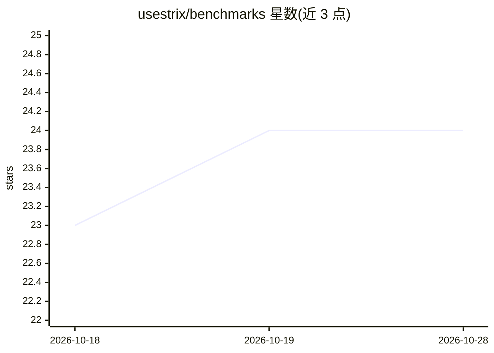

# usestrix/benchmarks

⭐ 24 · Python · Apache-2.0 · 推送 2026-09-30 · [GitHub](https://github.com/usestrix/benchmarks) · [官网](https://strix.ai) · 组织维护

**Strix 安全 agent 的基准评测框架**

为 Strix agent 提供标准化的基准评测基础设施，含针对安全任务的评测管线。当前收录一个基准 XBEN（XBOW Web 安全 CTF 挑战集，104 个挑战），README 声明正在持续增加更多基准。以仓库形式提供评测管线，供需要测试安全 agent 能力的使用者运行评测。信息量较少，细节（安装方式、评测流程）未在可见 README 中给出。

## 筛选速览

| 维度 | 判定 | 备注 |
|---|---|---|
| AI 角色 | `ai-ecosystem` | LLM/agent 周边工具 |
| 许可风险 | `permissive` | Apache-2.0 |
| 部署形态 | `None` |  |
| 模型依赖 | — | README 未给出锁定关系 |
| 硬件要求 | — | 无带数字的原话,不猜 |
| 安装摩擦 | `low` | 无编译、无系统依赖或容器化 |
| 成熟度 | — | 结构信号不足 |

## 能力要点

- 针对 Strix agent 的标准化评测管线
- 收录 XBEN 基准：XBOW Web 安全 CTF 挑战，104 个挑战
- 覆盖多种安全任务（README 声明）

## 适用场景

- 对 Strix agent 在 Web 安全 CTF 任务上的表现做基准评测
- 跟踪 Strix 的安全能力评测基准集合

## 场景标签

`模型评测` `网络安全` · 领域:评测与运维

## 证据(README 行号)

> L3: This repository contains benchmark evaluation infrastructure for Strix. It provides standardized evaluation pipeline

## 星数曲线

2026-10-18 23 → 2026-10-28 24（+1）

---
*卡片 v1 · prompt 1.4 · 生成 2026-10-27 · 置信度 mid · 依据 README sha `222553658e76` · [字段定义](../../DATASET.md)*
