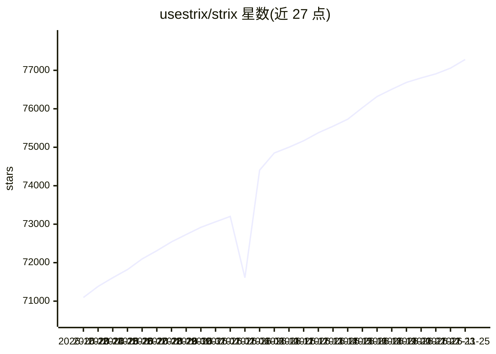

# usestrix/strix

⭐ 77,282 · Python · Apache-2.0 · 推送 2026-11-24 · [GitHub](https://github.com/usestrix/strix) · [官网](https://strix.ai) · 组织维护

**给开发与安全团队的自主 AI 渗透测试 agent 工具**

Strix 是以 CLI 运行的开源 AI 渗透测试工具：多个 AI agent 模拟真实攻击者，对代码、Web 应用和 API 执行侦察、利用与验证，输出带 PoC 的漏洞发现、CVSS/OWASP 分类、修复补丁与合规报告。要求 Docker 运行沙箱及任一支持的 LLM API key；亦提供云托管与企业版（SSO、自托管）。支持 GitHub Actions CI/CD 集成、headless 模式、MCP 服务器接入，以及面向 Claude Code/Cursor 等 agent 的九个 SKILL.md 技能安装。

## 筛选速览

| 维度 | 判定 | 备注 |
|---|---|---|
| AI 角色 | `ai-native` | 本体是模型或模型工具 |
| 许可风险 | `permissive` | Apache-2.0 |
| 部署形态 | `library` | 以包/库形式分发 |
| 模型依赖 | local-ok | 支持本地模型 |
| 硬件要求 | — | 无带数字的原话,不猜 |
| 安装摩擦 | `low` | 无编译、无系统依赖或容器化 |
| 成熟度 | — | 结构信号不足 |

## 动量与使用信号

- 维护:`active` — 距上次 push 2.5 天,年发版 30,73 位贡献者
- 涨星:近 1 天 **+275**(自 20261016 起算)
- 安装:npm 包 `skills` 月下载 23,786,800
- 平台:— · 协议:MCP / OLLAMA

## 能力要点

- 多 agent 编排的自动化渗透测试，产出可验证 PoC 与修复补丁
- 覆盖 OWASP Top 10：注入、SSRF、XSS、访问控制、API 安全等
- CI/CD 集成在 PR 上自动扫描，headless 模式供服务器调用
- 可连接自定义 MCP 服务器，并提供 agent-ready 技能包

## 适用场景

- 对应用做自动化渗透测试并生成合规报告
- 在 CI/CD 流水线中拦截带漏洞的代码合入
- 自动化 bug bounty 研究并生成 PoC
- 用 AI agent 一键调用渗透测试与修复能力

## 场景标签

`多智能体` `网络安全` · 领域:Agent 开发

## 证据(README 行号)

> L7: ### The open-source AI pentesting tool. Autonomous AI hackers that find and fix your app’s vulnerabilities.
> L30: Strix are autonomous AI penetration testing agents that act just like real hackers - they run your code dynamically

## 星数曲线

2026-10-23 71,095 → 2026-11-25 77,282（+6,187）

---
*卡片 v1 · prompt 1.4 · 生成 2026-11-22 · 置信度 high · 依据 README sha `ac48072fe952` · [字段定义](../../DATASET.md)*
