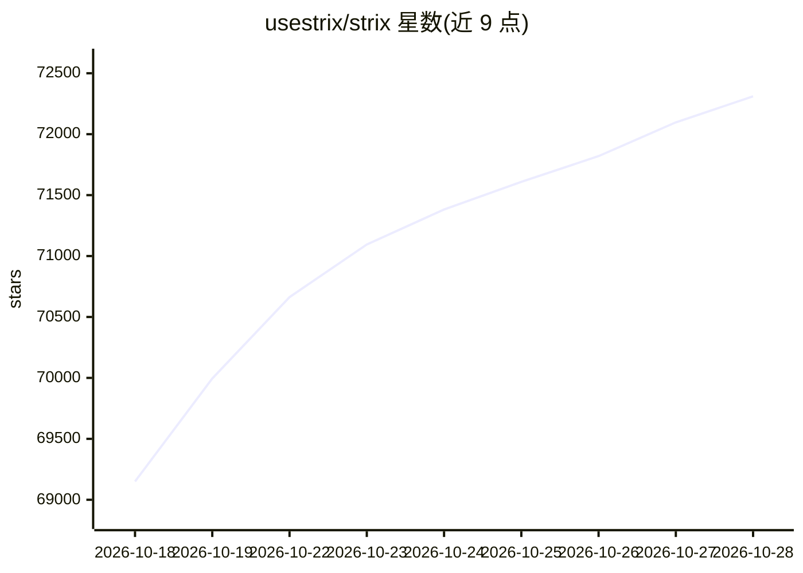

# usestrix/strix

⭐ 72,311 · Python · Apache-2.0 · 推送 2026-10-27 · [GitHub](https://github.com/usestrix/strix) · [官网](https://strix.ai) · 组织维护

**面向开发者与安全团队的自主 AI 渗透测试 agent 工具**

以 CLI 形式运行的自主渗透测试 agent：动态运行目标代码、发现漏洞并以实际 PoC 验证，覆盖 OWASP Top 10 类漏洞；支持多 agent 编排（Graph of Agents）分布式测试、SAST+DAST、自动生成补丁与合规报告，并可接入 GitHub Actions CI。运行依赖 Docker 沙箱与外部 LLM API key，推荐模型默认为 OpenRouter 上的 GLM-5.3；另提供 Strix Cloud 托管平台与企业版（SSO、VPC/自托管），本地 Web 查看器以 strix view 启动。

## 筛选速览

| 维度 | 判定 | 备注 |
|---|---|---|
| AI 角色 | `ai-native` | 本体是模型或模型工具 |
| 许可风险 | `permissive` | Apache-2.0 |
| 部署形态 | `library` | 以包/库形式分发 |
| 模型依赖 | local-ok | 支持本地模型 |
| 硬件要求 | — | 无带数字的原话,不猜 |
| 安装摩擦 | `low` | 无编译、无系统依赖或容器化 |
| 成熟度 | — | 结构信号不足 |

## 动量与使用信号

- 维护:`active` — 距上次 push 2.5 天,年发版 30,73 位贡献者
- 涨星:近 1 天 **+275**(自 20261016 起算)
- 安装:npm 包 `skills` 月下载 23,786,800
- 平台:— · 协议:MCP / OLLAMA

## 能力要点

- 多 agent 编排：侦察/利用/后渗透分工协作
- 以可运行 PoC 验证漏洞，并自动生成修复补丁与合规报告
- 支持 OpenAPI/Swagger/Postman 合约驱动的 API 测试与无头模式
- 可接入外部 MCP 服务器扩展 agent 工具

## 适用场景

- 对应用做自动化渗透测试并输出合规报告
- 在 CI/CD 中扫描 PR 并阻断不安全代码
- 自动化 bug bounty 研究与 PoC 生成
- 对接 API 合约文件批量测试声明的端点

## 场景标签

`网络安全` `代码审查` · 领域:编码与开发

## 证据(README 行号)

> L30: Strix are autonomous AI penetration testing agents that act just like real hackers - they run your code dynamically
> L55: - An LLM API key from any supported provider (OpenAI, Anthropic, Google, etc.)
> L148: - **Distributed Pentesting** - Specialized AI agents for recon, exploitation, and post-exploitation

## 星数曲线

2026-10-18 69,150 → 2026-10-28 72,311（+3,161）

---
*卡片 v1 · prompt 1.4 · 生成 2026-10-18 · 置信度 mid · 依据 README sha `f22f931752ac` · [字段定义](../../DATASET.md)*
