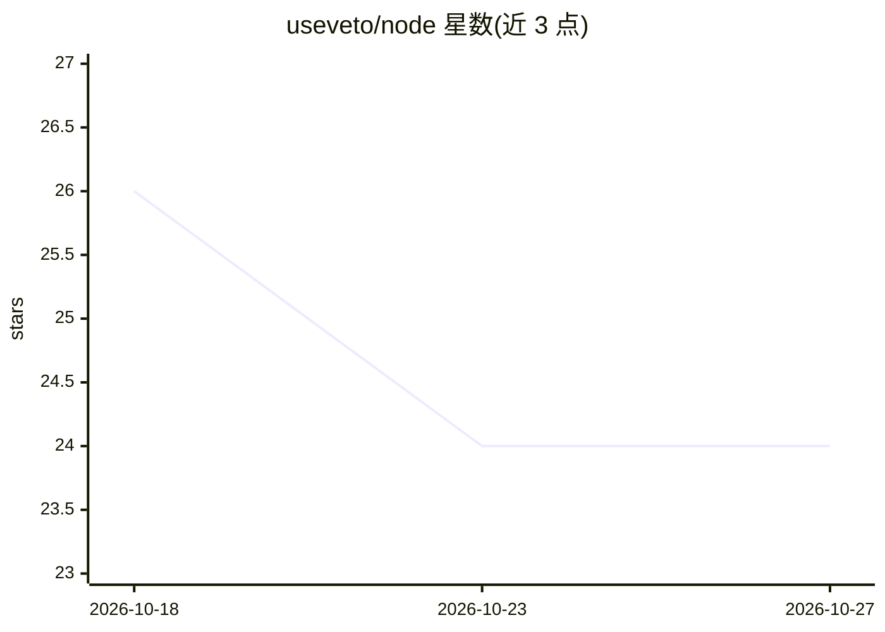

# useveto/node

⭐ 24 · TypeScript · MIT · 推送 2026-04-04 · [GitHub](https://github.com/useveto/node) · [官网](https://veto.tools) · 组织维护

**AI agent 运行时授权 SDK：拦截工具调用并按策略放行/拒绝**

Node.js/TypeScript SDK，为 AI agent 提供运行时授权层：拦截每一次工具调用，依据策略评估返回 allow/deny/escalate，默认拒绝（default deny），服务不可达时同样默认拒绝（fail-closed，可覆盖为 fail-open）。提供 MCP 原生中间件（Guard 包装器或手动中间件）、Agent/策略/审计日志的 API，每次决策记录审计日志。需要 VETO_API_KEY 连接托管服务（默认 endpoint api.veto.tools），后端运行于 Cloudflare Workers。

## 筛选速览

| 维度 | 判定 | 备注 |
|---|---|---|
| AI 角色 | `ai-ecosystem` | LLM/agent 周边工具 |
| 许可风险 | `permissive` | MIT |
| 部署形态 | `library` | 以包/库形式分发 |
| 模型依赖 | — | README 未给出锁定关系 |
| 硬件要求 | — | 无带数字的原话,不猜 |
| 安装摩擦 | `low` | 无编译、无系统依赖或容器化 |
| 成熟度 | — | 结构信号不足 |

## 能力要点

- 拦截 agent 工具调用，按策略返回 allow/deny/escalate，默认拒绝
- MCP 中间件两种接入方式：Guard 包装器与手动中间件
- 每次决策写入可查询的审计日志
- 网络故障时 fail-closed 默认拒绝，可配置覆盖

## 适用场景

- 给 MCP server 的工具调用加策略授权，拒绝越权操作
- 为多个 agent 配置与管理授权策略并保留审计记录
- 生产环境对 agent 行为做默认拒绝的访问控制

## 场景标签

 · 领域:AI agent 安全基础设施

## 证据(README 行号)

> L10: Veto intercepts every tool call your AI agent makes, evaluates it against your policies, and decides: **allow**, **
> L13: - **MCP native** — drop-in middleware for Model Context Protocol servers

## 星数曲线

2026-10-18 26 → 2026-10-27 24（-2）

---
*卡片 v1 · prompt 1.4 · 生成 2026-10-27 · 置信度 high · 依据 README sha `55471a537961` · [字段定义](../../DATASET.md)*
