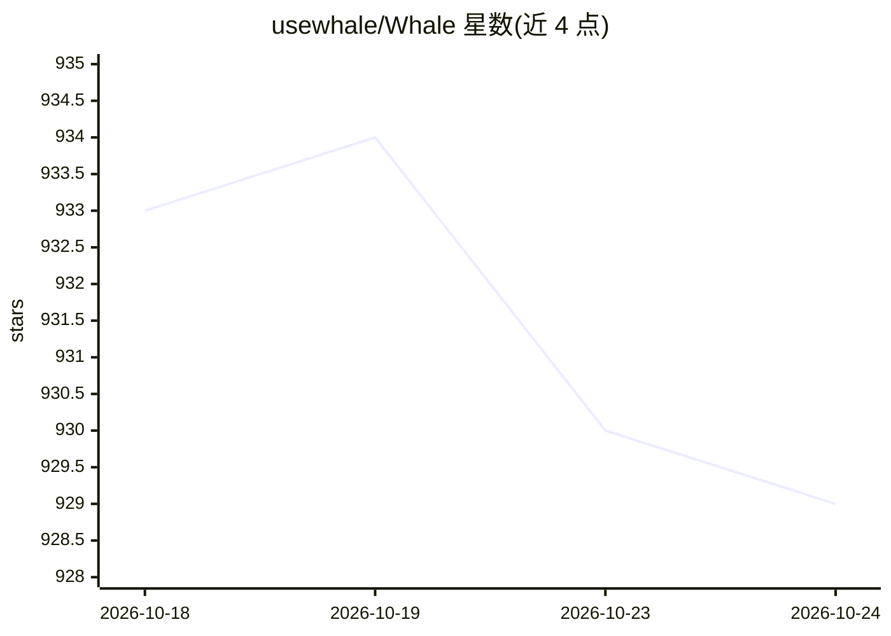

# usewhale/Whale

⭐ 929 · Go · MIT · 推送 2026-10-14 · [GitHub](https://github.com/usewhale/Whale) · [官网](https://wirebox.sh) · 组织维护 · 中文 README

**面向 DeepSeek 的终端 AI 编码 agent（已停止维护）**

基于 Go 的终端优先 AI 编码 agent，专为 DeepSeek 长上下文（1M tokens）与工具调用构建：可读文件、执行命令、编辑代码、搜索网页。提供 TUI 交互、CLI 单次提问与 headless 模式（用于 CI/CD 与自动 PR 审查）。支持约 98% 提示缓存命中率、JavaScript 编写的多 agent 动态工作流（兼容 Claude Code 脚本）、1,000+ MCP 服务器接入、技能/插件/子 agent/钩子扩展。README 明确声明项目已停止维护，建议改用官方 DeepSeek Harness。

## 筛选速览

| 维度 | 判定 | 备注 |
|---|---|---|
| AI 角色 | `ai-native` | 本体是模型或模型工具 |
| 许可风险 | `permissive` | MIT |
| 部署形态 | `library` | 以包/库形式分发 |
| 模型依赖 | locked-api |  |
| 硬件要求 | — | 无带数字的原话,不猜 |
| 安装摩擦 | `low` | 无编译、无系统依赖或容器化 |
| 成熟度 | — | 结构信号不足 |

## 能力要点

- DeepSeek 专属优化：1M 上下文、工具调用、约 98% 提示缓存命中
- JavaScript 多 agent 动态工作流，兼容 Claude Code 脚本
- 接入 1,000+ MCP 服务器，支持 Skills/插件/子 agent/钩子
- TUI、CLI、headless 三种运行界面

## 适用场景

- 在终端里让 agent 读代码、改代码、跑命令完成编码任务
- 在 CI/CD 中做自动化 PR 审查与定时任务
- 用 JavaScript 脚本编排多 agent 并行研究与审查流程

## 场景标签

`编码 Agent` `代码审查` · 领域:编码与开发

## 证据(README 行号)

> L21:  Whale — AI coding agent for DeepSeek, in any environment.
> L67: That's it. Type your question and Whale starts working — reading files, running commands,

## 星数曲线

2026-10-18 933 → 2026-10-24 929（-4）

---
*卡片 v1 · prompt 1.4 · 生成 2026-10-21 · 置信度 high · 依据 README sha `585c8043802d` · [字段定义](../../DATASET.md)*
