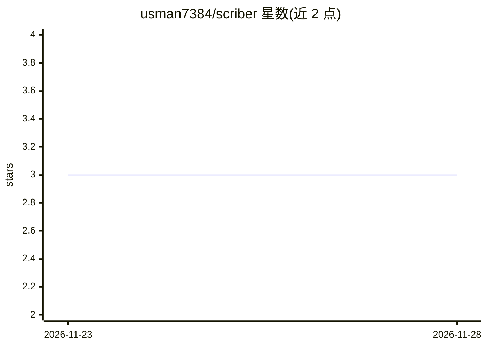

# usman7384/scriber

⭐ 3 · Python · Apache-2.0 · 推送 2026-11-15 · [GitHub](https://github.com/usman7384/scriber) · 个人维护

**机械 CAD 设计 agent：文字生成参数化可编辑 B-rep 零件**

面向机械设计的开源设计 agent：用户输入文字提示、规格文件、草图或网格，系统先抽取需求并转为可测量的检查项，模型写出类型化的设计 IR，确定性编译器将其编译为 build123d 脚本，在沙箱 worker 中构建实体，再经有效性、需求、规则与 DFM 检查，失败时进入最多五轮修复循环。输出 STEP、STL、GLB、FreeCAD 文件与脚本，参数修改重编译无需再调用模型。默认通过 Ollama 使用本地 Qwen 模型离线运行，README 注明对复杂零件尚不可靠。

## 筛选速览

| 维度 | 判定 | 备注 |
|---|---|---|
| AI 角色 | `ai-native` | 本体是模型或模型工具 |
| 许可风险 | `permissive` | Apache-2.0 |
| 部署形态 | `None` |  |
| 模型依赖 | local-ok | 支持本地模型 |
| 硬件要求 | — | 无带数字的原话,不猜 |
| 安装摩擦 | `medium` | 含编译或系统依赖之一 |
| 成熟度 | `idea` | |

## 能力要点

- 文字/规格/草图/网格输入，输出参数化 B-rep 零件与 build123d 脚本
- 需求转为可测量检查项，失败自动修复最多五轮
- 参数编辑重编译，无需调用模型
- 本地 Qwen 模型（Ollama）离线运行，提供 Web 编辑器、API 与 CLI

## 适用场景

- 用一句话生成垫片、支架、法兰、齿轮等参数化零件
- 改一个参数（如齿数）让关联尺寸自动跟随更新
- 基于上传的工程文档与项目规则生成并校验设计
- 对设计做孔边距、壁厚等可制造性检查

## 场景标签

`代码生成` · 领域:编码与开发

## 证据(README 行号)

> L3: **An open-source design agent for mechanical CAD.** Describe a part in plain words and get a parametric, editable B-
> L5: The model never draws geometry. It writes a typed design, a compiler turns that into a solid, and the result is chec
> L55: - **Requirements.** Dimensions and counts stated in the request become checks that are measured on the built solid:

## 星数曲线

2026-11-23 3 → 2026-11-28 3（+0）

---
*卡片 v1 · prompt 1.4 · 生成 2026-11-23 · 置信度 high · 依据 README sha `397519b054bb` · [字段定义](../../DATASET.md)*
