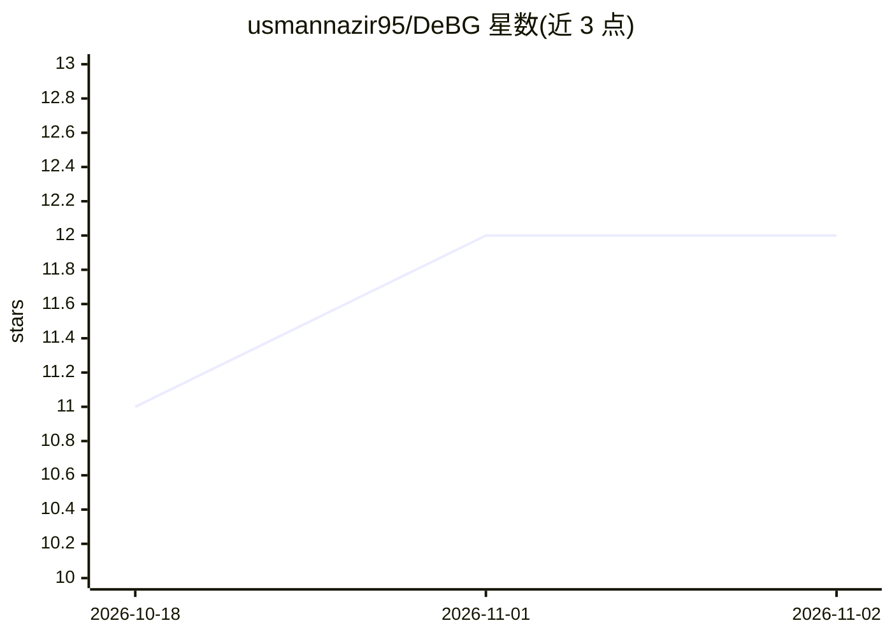

# usmannazir95/DeBG

⭐ 12 · JavaScript · MIT · 推送 2026-05-24 · [GitHub](https://github.com/usmannazir95/DeBG) · 个人维护

**Windows 离线批量抠图桌面应用，本地运行 AI 模型产出透明 PNG**

基于 Electron + React 的 Windows 桌面抠图工具，内置 danielgatis/rembg 作为本地推理服务器，在 127.0.0.1 提供 HTTP API，图像处理全程在本机完成，首次下载模型后无需联网。支持拖放批量处理 PNG/JPG/WEBP/BMP，可选 9 种模型（4.7 MB 至 375 MB BiRefNet），CPU 与 NVIDIA CUDA 后端可在应用内切换，并提供阈值、边缘羽化、alpha matting 等后处理滑杆实时重应用。首次运行向导自动检测或下载 Python、创建 venv 并安装 rembg，无需手动配置。面向需要在本地批量去除图片背景的 Windows 用户。

## 筛选速览

| 维度 | 判定 | 备注 |
|---|---|---|
| AI 角色 | `ai-native` | 本体是模型或模型工具 |
| 许可风险 | `permissive` | MIT |
| 部署形态 | `desktop` | 安装包/桌面程序 |
| 模型依赖 | — | README 未给出锁定关系 |
| 硬件要求 | — | 无带数字的原话,不猜 |
| 安装摩擦 | `medium` | 含编译或系统依赖之一 |
| 成熟度 | — | 结构信号不足 |

## 能力要点

- rembg 以本地 HTTP 服务方式运行，全程离线、无上传
- 9 种可选模型，从 4.7 MB 轻量模型到 375 MB BiRefNet
- CPU / CUDA GPU 后端可在应用内随时切换
- 阈值、羽化、收缩/扩展等后处理参数即时重应用，无需重跑推理

## 适用场景

- 在本地批量去除图片背景并导出透明 PNG，不上传云端
- 为电商、人像、动漫等不同主体选用对应模型抠图
- 通过滑杆实时调整抠图边缘效果并批量导出 ZIP

## 场景标签

`图像视频处理` · 领域:感知与多模态

## 证据(README 行号)

> L11: **DeBG** is a Windows desktop background remover. Drop images in, get transparent PNGs out.
> L12: Powered by danielgatis/rembg running as a local AI inference server. Everything stays on your machine. No internet 
> L19: - **9 AI models** - from tiny 4.7 MB to high-quality 375 MB BiRefNet models

## 星数曲线

2026-10-18 11 → 2026-11-02 12（+1）

---
*卡片 v1 · prompt 1.4 · 生成 2026-10-31 · 置信度 high · 依据 README sha `49ed6ee6a1cd` · [字段定义](../../DATASET.md)*
