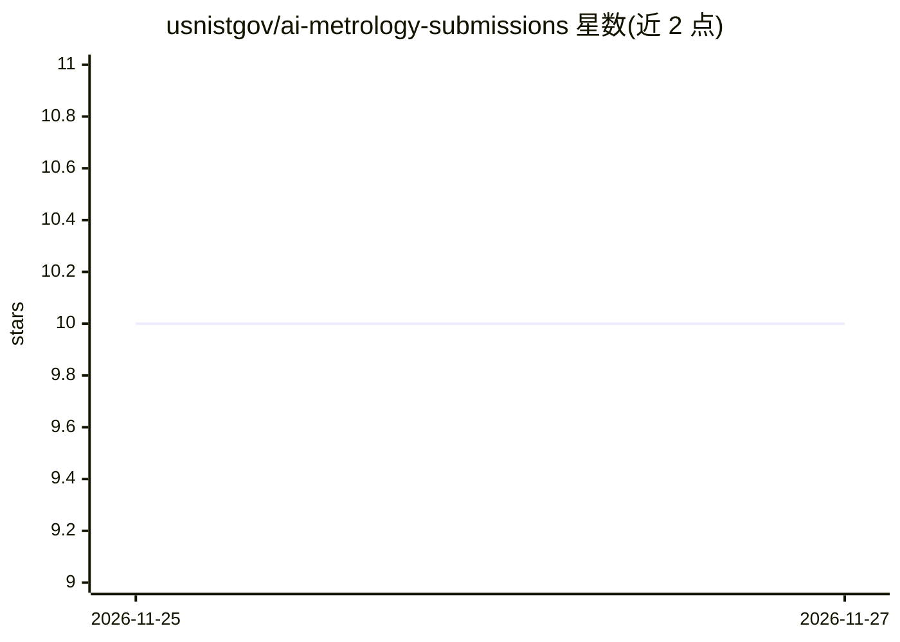

# usnistgov/ai-metrology-submissions

⭐ 10 · Python · 推送 2026-09-14 · [GitHub](https://github.com/usnistgov/ai-metrology-submissions) · [官网](https://airc.nist.gov/metrology/) · 组织维护

**向 NIST AI 计量中心提交 AI 指标的公共入口**

该仓库是 NIST AI Metrology Center 的社区投稿入口：贡献者通过 GitHub pull request 提交一个 YAML 文件，描述一个 AI 指标或测量方法（基准、红队方法、评估流程等 TEVV 类内容），评审在 PR 上公开进行，被合并的提交将被考虑发布到 AI Metrology Center。仓库提供提交指南、格式规范与内容标准，并保留两个示例 PR 供参考。README 明确说明该流程为初次建立，格式与响应时间可能调整；提交内容公开、视为非机密披露。

## 筛选速览

| 维度 | 判定 | 备注 |
|---|---|---|
| AI 角色 | `ai-knowledge` | 知识聚合/清单类 |
| 许可风险 | `none` | — |
| 部署形态 | `None` |  |
| 模型依赖 | — | README 未给出锁定关系 |
| 硬件要求 | — | 无带数字的原话,不猜 |
| 安装摩擦 | `low` | 无编译、无系统依赖或容器化 |
| 成熟度 | `idea` | |

## 能力要点

- 通过 pull request 提交单个 YAML 文件描述指标或测量方法
- 评审在 PR 上公开进行，合并后进入 NIST AI Metrology Center 收录流程
- 范围覆盖 AI TEVV 的指标、基准、红队方法与评估流程
- 提供提交指南、格式规范与两个示例提交 PR

## 适用场景

- 向 NIST AI Metrology Center 提交自研 AI 评估指标
- 公开评审环境下协作完善测量方法学条目
- 查阅已有指标提交的格式与评审流程示例

## 场景标签

`模型评测` · 领域:评测与运维

## 证据(README 行号)

> L3: This repository is the public intake point for **community submissions of AI metrics and
> L19: Metrics (quantitative or qualitative measures) **and** measurement methodologies

## 星数曲线

2026-11-25 10 → 2026-11-27 10（+0）

---
*卡片 v1 · prompt 1.4 · 生成 2026-11-24 · 置信度 high · 依据 README sha `c5f5b5feed0f` · [字段定义](../../DATASET.md)*
