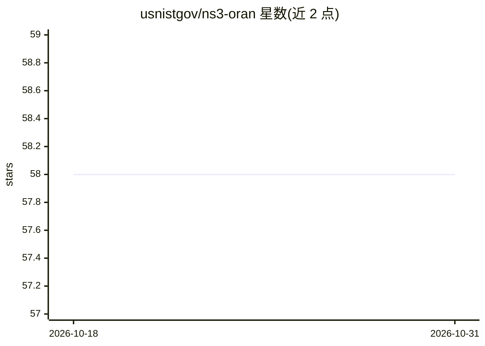

# usnistgov/ns3-oran

⭐ 58 · C++ · NOASSERTION · 推送 2026-05-26 · [GitHub](https://github.com/usnistgov/ns3-oran) · 组织维护

**NIST 开发的 ns-3 O-RAN 网络仿真建模模块**

由 NIST 通信技术实验室开发的 ns-3 contrib 模块，按 O-RAN 规范建模网络架构：实现功能上等价于 Near-RT RIC 的 RIC 模型、附着在仿真节点上的上报模块（类似 E2 终结点）、SQLite 数据仓库、可插拔的 Logic Module（对应 xApp）、冲突缓解 API 与 LTE-to-LTE 切换命令生成。可选集成 ONNX Runtime 与 PyTorch，在仿真中调用已训练的 ML 模型做推理。最低要求 ns-3.42 与 SQLite，通过 clone 到 contrib 目录后重新编译 ns-3 使用。项目声明已 feature complete，按 best effort 维护。

## 筛选速览

| 维度 | 判定 | 备注 |
|---|---|---|
| AI 角色 | `ai-enhanced` | 去掉 AI 部分产品仍成立 |
| 许可风险 | `none` | NOASSERTION |
| 部署形态 | `None` |  |
| 模型依赖 | — | README 未给出锁定关系 |
| 硬件要求 | — | 无带数字的原话,不猜 |
| 安装摩擦 | `medium` | 含编译或系统依赖之一 |
| 成熟度 | — | 结构信号不足 |

## 能力要点

- Near-RT RIC 模型与充当 xApp 的可插拔 Logic Module 机制
- SQLite 数据仓库存储 RIC 与模块间交互数据及日志
- 可选集成 ONNX Runtime 与 PyTorch，在仿真中运行已训练 ML 模型推理
- 节点位置与 LTE 小区附着周期上报、LTE-to-LTE 切换命令生成与执行

## 适用场景

- 在 ns-3 中仿真与验证 O-RAN 架构下的 RIC/xApp 方案
- 研究者实现自定义 Logic Module 算法并评估切换等控制决策
- 将外部训练的 ML 模型（ONNX/PyTorch）接入仿真做推理实验

## 场景标签

 · 领域:无线网络仿真/O-RAN

## 证据(README 行号)

> L25: The `oran` module for `ns-3` implements the classes required to model a
> L27: a RAN Intelligent Controller (RIC) that is functionally equivalent to
> L211: ML is not required to use this module, however, we provide a means of

## 星数曲线

2026-10-18 58 → 2026-10-31 58（+0）

---
*卡片 v1 · prompt 1.4 · 生成 2026-10-24 · 置信度 high · 依据 README sha `e0a2a47a09d9` · [字段定义](../../DATASET.md)*
