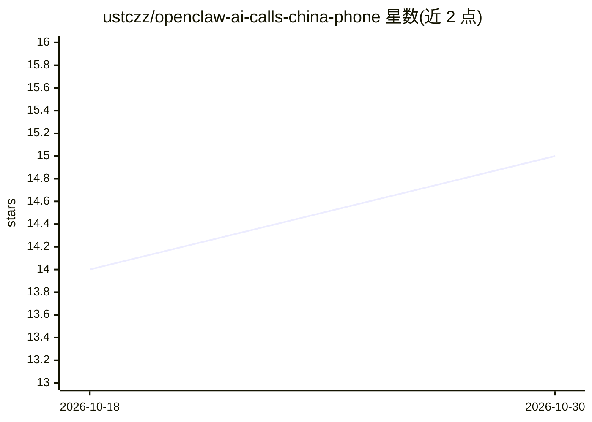

# ustczz/openclaw-ai-calls-china-phone

⭐ 15 · Python · MIT-0 · 推送 2026-09-07 · [GitHub](https://github.com/ustczz/openclaw-ai-calls-china-phone) · [官网](https://open-skill.steponeai.com) · 个人维护 · 中文 README

**面向 OpenClaw 的中文 AI 电话外呼/呼入 Skill，拨打真实电话**

以 OpenClaw Skill 形式提供的电话机器人工具：通过 openclaw skills install 安装后，用户以自然语言指令让 OpenClaw 拨打中国大陆手机号（11 位或 +86），完成订位、回访、催办等外呼任务，并返回通话状态、费用、转写与实时对话记录。支持网页控制台配置 AI 呼入接待（欢迎语、提示词、号码绑定）。安全机制包括单号码 + --confirm 逐次确认门禁、API Key 仅从环境变量读取、Idempotency-Key 幂等追踪。呼入号码绑定需在网页控制台完成，公开 API 不提供该接口；国际号码需使用 ClawCall International。

## 筛选速览

| 维度 | 判定 | 备注 |
|---|---|---|
| AI 角色 | `ai-ecosystem` | LLM/agent 周边工具 |
| 许可风险 | `permissive` | MIT-0 |
| 部署形态 | `None` |  |
| 模型依赖 | — | README 未给出锁定关系 |
| 硬件要求 | — | 无带数字的原话,不猜 |
| 安装摩擦 | `low` | 无编译、无系统依赖或容器化 |
| 成熟度 | — | 结构信号不足 |

## 能力要点

- AI 外呼：订位、回访、催办、询价等真实电话任务并返回通话结果
- AI 呼入接待：欢迎语、接待提示词、共享/独立呼入号码配置
- 通话记录查询：状态、费用、转写与实时对话
- 安全门禁：每次仅拨一个号码，逐次确认后才真实呼叫

## 适用场景

- 让 AI 替我给餐厅订位、给客户做售后回访
- 配置电话机器人接听客户来电并记录姓名和需求
- 查询历史通话的转写、状态与费用

## 场景标签

`语音 Agent` · 领域:对话与助手

## 证据(README 行号)

> L3: 对 OpenClaw 说一句话，让 AI 帮你拨打真实电话、完成沟通任务并返回通话结果。支持中文
> L25: openclaw skills verify @ustczz/ai-calls-china-phone
> L41: - 电话机器人：按目标自主交流，处理打断并返回通话结果

## 星数曲线

2026-10-18 14 → 2026-10-30 15（+1）

---
*卡片 v1 · prompt 1.4 · 生成 2026-10-30 · 置信度 high · 依据 README sha `7a878b763d6b` · [字段定义](../../DATASET.md)*
