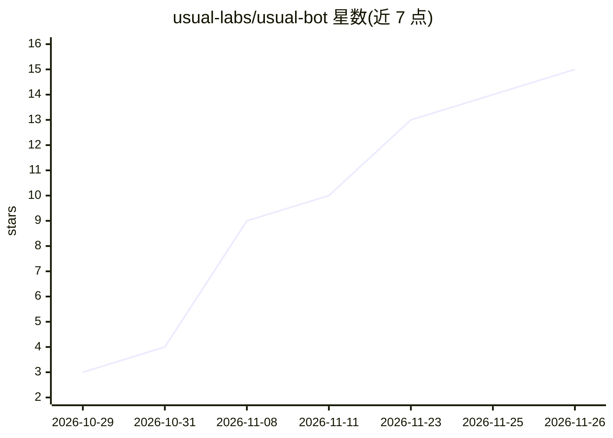

# usual-labs/usual-bot

⭐ 15 · Swift · Apache-2.0 · 推送 2026-11-25 · [GitHub](https://github.com/usual-labs/usual-bot) · [官网](https://github.com/usual-labs/usual-bot/releases/latest) · 组织维护

**Mac/iPhone 原生消息客户端：连接 Hermes 网关与 Bot 对话**

面向运行 Hermes 网关的用户的开源原生消息应用（Swift/SwiftUI，Apache-2.0），把 Hermes Bot Mode 里的每个 Bot 呈现为联系人：单聊、多 Bot 群聊（rooms）、流式回复、工具调用审批、/goal 目标、/bg 后台任务、定时 routines、语音通话与 ⌥Space 快捷面板。设置与技能配置保留在官方 Hermes 应用中，本应用只负责对话与审批。需 macOS 26/iOS 26 以上，经 TestFlight 测试版分发或从源码构建，需已开启 Webapp 的 Hermes 网关。

## 筛选速览

| 维度 | 判定 | 备注 |
|---|---|---|
| AI 角色 | `ai-ecosystem` | LLM/agent 周边工具 |
| 许可风险 | `permissive` | Apache-2.0 |
| 部署形态 | `None` |  |
| 模型依赖 | — | README 未给出锁定关系 |
| 硬件要求 | — | 无带数字的原话,不猜 |
| 安装摩擦 | `medium` | 含编译或系统依赖之一 |
| 成熟度 | `idea` | |

## 能力要点

- 每个 Bot 一个联系人聊天，群聊 rooms、@name 点名
- 命令审批内联在对话中（一次/本聊天/总是/拒绝）
- /goal、/bg、routines、/btw 侧问等 Bot 交互命令
- 端上语音或网关 GPT-Live 语音通话

## 适用场景

- 在 Mac/iPhone 上与自托管 Hermes 网关的 Bot 对话并审批其命令
- 把多个 Bot 拉进一个房间协同回复
- 用后台任务与推送在应用关闭时接收 Bot 结果

## 场景标签

`聊天机器人` `AI 助手` `语音 Agent` · 领域:对话与助手

## 证据(README 行号)

> L20: Usual Bot connects to the Hermes gateway you already run and works with Hermes
> L24: Bots are working and which need you. It does one thing well: talking to your Bots. Settings,
> L140: - **A Hermes gateway** with its Webapp on (`webapp.enabled`, port 9120), reachable from your

## 星数曲线

2026-10-29 3 → 2026-11-26 15（+12）

---
*卡片 v1 · prompt 1.4 · 生成 2026-11-19 · 置信度 high · 依据 README sha `32bd752886d4` · [字段定义](../../DATASET.md)*
