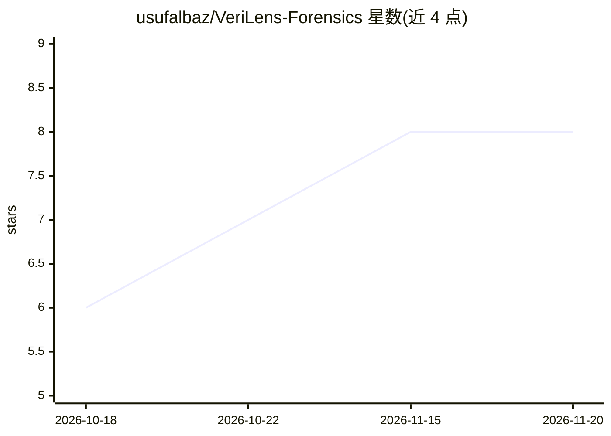

# usufalbaz/VeriLens-Forensics

⭐ 8 · Python · MIT · 推送 2026-11-06 · [GitHub](https://github.com/usufalbaz/VeriLens-Forensics) · [官网](https://vericore-forensics.vercel.app/) · 个人维护

**面向图像取证场景的多引擎合成媒体与深度伪造检测平台**

VeriLens Forensics 是一个图像取证框架，通过多引擎混合架构检测 AI 生成图像、面部深度伪造与 Photoshop 篡改：2D-FFT 频域分析识别生成上采样引入的高频网格残留，ELA 定位空间篡改区域，生物特征引擎分析角膜反射与瞳光一致性，元数据引擎校验传感器配置、检测 Photoshop/GIMP 标签并检查 C2PA/生成式提示。提供 FastAPI 后端微服务（Base64 遥测流）与网络安全仪表盘，MIT 许可。

## 筛选速览

| 维度 | 判定 | 备注 |
|---|---|---|
| AI 角色 | `ai-native` | 本体是模型或模型工具 |
| 许可风险 | `permissive` | MIT |
| 部署形态 | `None` |  |
| 模型依赖 | — | README 未给出锁定关系 |
| 硬件要求 | — | 无带数字的原话,不猜 |
| 安装摩擦 | `low` | 无编译、无系统依赖或容器化 |
| 成熟度 | — | 结构信号不足 |

## 能力要点

- 2D-FFT 频域谱分析引擎，含径向分解与高频比值基准
- ELA 篡改定位与法证热力图掩码生成
- EXIF/C2PA 元数据校验与 AI 工具签名解析
- Haar cascade 人脸定位与角膜反射一致性验证

## 适用场景

- 检测社交媒体图片是否为 AI 生成或深度伪造
- 定位图像中被局部篡改（拼接/复制移动）的区域
- 核查图像元数据中的编辑软件痕迹与来源信息

## 场景标签

`网络安全` · 领域:学习与行业

## 证据(README 行号)

> L2: > Production-Grade Multi-Engine Forensic Framework for Detecting Synthetic Media, Facial Deepfakes, and Digital Tamp
> L13: **VeriLens Forensics** addresses this vulnerability by deploying a **Multi-Engine Hybrid Forensic Architecture**:
> L14: 1. **Frequency-Domain Spectral Profiling (2D-FFT):** Identifies anomalous high-frequency grid residue and unnatural

## 星数曲线

2026-10-18 6 → 2026-11-20 8（+2）

---
*卡片 v1 · prompt 1.4 · 生成 2026-11-20 · 置信度 high · 依据 README sha `936e73828d13` · [字段定义](../../DATASET.md)*
