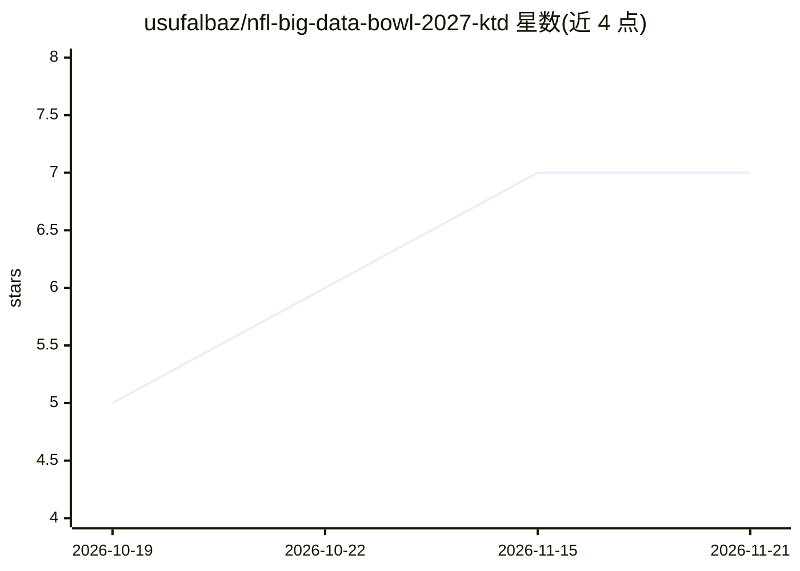

# usufalbaz/nfl-big-data-bowl-2027-ktd

⭐ 7 · Python · MIT · 推送 2026-10-29 · [GitHub](https://github.com/usufalbaz/nfl-big-data-bowl-2027-ktd) · 个人维护

**面向 NFL 球探的选秀表现预测生物力学指标研究项目**

Kaggle NFL Big Data Bowl 2027 的参赛提交项目：提出 Kinetic Translation Deficit (KTD) 生物力学框架，基于 10 Hz RFID 追踪数据，比较球员在体测（Combine）与常规赛同类型路线中的运动学衰减，计算 KTD 分数。对 106 名外接手做 Spearman 相关与 5 折交叉验证 ROC 分类，仓库含提取的运动学数据集（CSV）、源码与图表，MIT 许可，目标读者为 NFL 管理层与球探人员。README 未给出安装或运行说明。

## 筛选速览

| 维度 | 判定 | 备注 |
|---|---|---|
| AI 角色 | `ai-knowledge` | 知识聚合/清单类 |
| 许可风险 | `permissive` | MIT |
| 部署形态 | `None` |  |
| 模型依赖 | — | README 未给出锁定关系 |
| 硬件要求 | — | 无带数字的原话,不猜 |
| 安装摩擦 | `low` | 无编译、无系统依赖或容器化 |
| 成熟度 | — | 结构信号不足 |

## 能力要点

- KTD 分数：以体测减速量与比赛分离距离之比量化动作机制转化效率
- 106 名 2023–2025 届外接手的 Spearman 相关与 ROC-AUC 统计验证
- 提供提取好的运动学主数据集 ktd_wr_metrics.csv
- 技术栈为 Python 3.10+、Pandas、NumPy、SciPy、Scikit-Learn

## 适用场景

- 作为 Kaggle 竞赛体育分析方向的参考实现
- 研究体测数据与比赛追踪数据的生物力学对比方法
- 复用其运动学指标数据集做二次分析

## 场景标签

 · 领域:体育分析/运动科学

## 证据(README 行号)

> L2: ### NFL Big Data Bowl 2027 Submission | Sensor Tracking from Combine to Regular Season
> L45: ### Machine Learning Classification (Above-Median Separation)
> L70: └── ktd_wr_metrics.csv                # Extracted kinematic master dataset

## 星数曲线

2026-10-19 5 → 2026-11-21 7（+2）

---
*卡片 v1 · prompt 1.4 · 生成 2026-11-20 · 置信度 high · 依据 README sha `378f17e7d3e4` · [字段定义](../../DATASET.md)*
